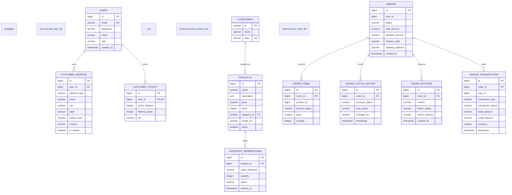

# Universal Commerce Platform (UCP) — Database Ownership & Data Architecture

## 1. Core Principles of Database Ownership

1. **Strict Service-to-Database Isolation:**
   Each microservice owns its private database. No service is allowed to read or write directly to another service's database schema. Cross-service data requirements are fulfilled via synchronous REST APIs or asynchronous Kafka events.
2. **Flyway Migration Governance:**
   All schema modifications, table creations, and index additions are managed through version-controlled Flyway SQL migrations. Hibernate `ddl-auto` is strictly set to `validate` in all environments.
3. **Soft Deletions & Auditability:**
   Entity records include audit metadata (`created_at`, `updated_at`, `version`) to ensure immutable transaction logs and prevent data corruption.

---

## 2. Service Database Catalog

### 2.1 `user_db` (Owned by `user-service`)
- **Connection URL:** `jdbc:postgresql://postgres:5432/user_db`
- **Flyway Migrations:**
  - [`V1__init_user_schema.sql`](file:///d:/practical/ecommerce-platform/backend/user-service/src/main/resources/db/migration/V1__init_user_schema.sql): Creates `users` table with unique constraint on `email`.
  - [`V2__customer_loyalty_and_addresses.sql`](file:///d:/practical/ecommerce-platform/backend/user-service/src/main/resources/db/migration/V2__customer_loyalty_and_addresses.sql): Creates `customer_address` and `customer_loyalty` tables with indexes on `user_id`.

### 2.2 `product_db` (Owned by `product-service`)
- **Connection URL:** `jdbc:postgresql://postgres:5432/product_db`
- **Flyway Migrations:**
  - `V1__init_product_schema.sql`: Creates `categories` and `products` tables.
  - `V2__inventory_reservation_schema.sql`: Creates `inventory_reservations` with index on `expires_at` and `status`.

### 2.3 `order_db` (Owned by `order-service`)
- **Connection URL:** `jdbc:postgresql://postgres:5432/order_db`
- **Flyway Migrations:**
  - `V1__init_order_schema.sql`: Creates `orders` and `order_items` tables with cascade delete on items.
  - `V2__order_lifecycle_and_returns.sql`: Creates `order_status_history` and `order_returns` tables.
  - `V3__accounting_ledger_schema.sql`: Creates `ledger_transactions` for double-entry financial reconciliation.
- **Performance Indexes:**
  - `idx_orders_created_at` on `orders(created_at)`: Accelerates time-range aggregation queries.
  - `idx_orders_user_status` on `orders(user_id, status)`: Accelerates customer order queries and cohort analytics.
  - `idx_order_items_product_id` on `order_items(product_id)`: Accelerates product sales rankings.

### 2.4 `notification_db` (Owned by `notification-service`)
- **Connection URL:** `jdbc:postgresql://postgres:5432/notification_db`
- **Flyway Migrations:**
  - `V1__init_notification_schema.sql`: Creates `notifications` and `notification_templates`.
  - `V2__notification_retry_tracking.sql`: Adds retry counters, last delivery failure reason, and status indices.
