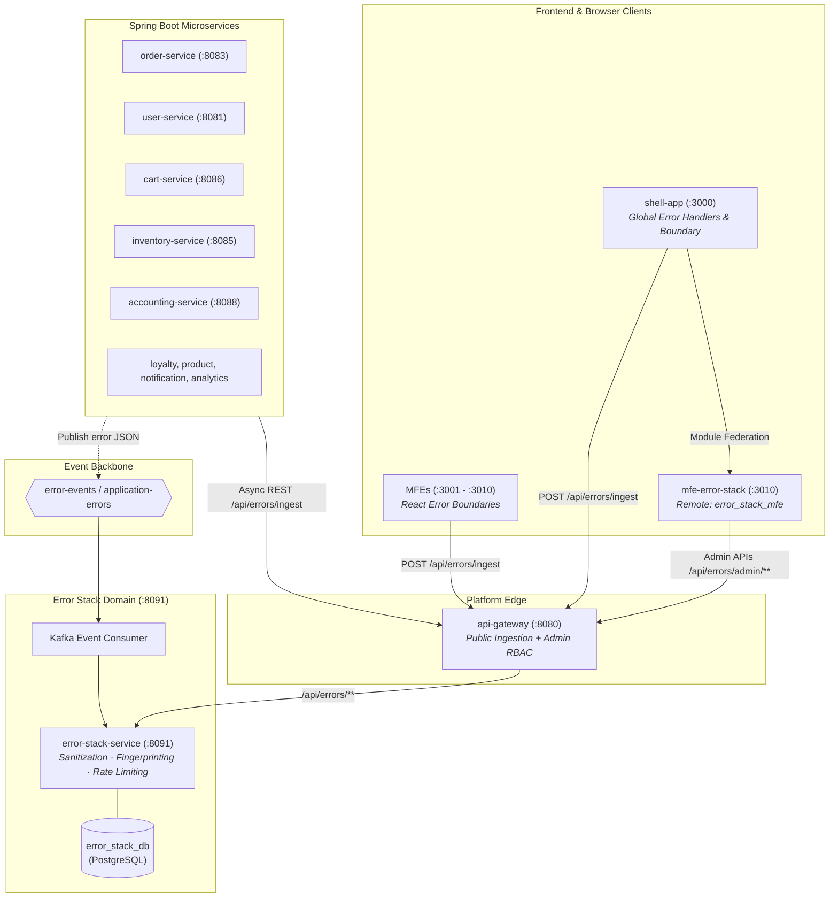

# Error Stack Service Architecture & Operator Guide

Universal Commerce Platform (UCP) v2.0.0 — Authoritative Error Intelligence, Sanitization, Grouping, and Triage Engine.

---

## 1. Executive Overview

The **Error Stack Service** (`error-stack-service`) provides centralized, authenticated, asynchronous error ingestion and triage diagnostics for all platform backend microservices and frontend microfrontends. It operates completely independently of other business domain databases with its own isolated persistence schema (`error_stack_db`).



---

## 2. Ingestion Contracts & Data Format

Errors can be ingested synchronously via HTTP (`POST /api/errors/ingest`) or asynchronously via Kafka topic `error-events` / `application-errors`.

### 2.1 JSON Ingestion Schema

```json
{
  "serviceName": "order-service",
  "environment": "production",
  "version": "2.0.0",
  "releaseTag": "v2.0.0-rel",
  "errorType": "PaymentGatewayTimeoutException",
  "message": "Stripe webhook acknowledgement timed out after 30000ms",
  "stackTrace": "com.ecommerce.order.service.OrderService.charge(OrderService.java:214)\n\tat com.ecommerce.order.controller.OrderController.checkout(OrderController.java:82)",
  "exceptionChain": "Caused by: java.net.SocketTimeoutException: Read timed out",
  "requestMethod": "POST",
  "requestUri": "/api/orders/checkout",
  "responseStatus": 504,
  "traceId": "4c49615d-order-trace-001",
  "correlationId": "corr-8849",
  "userId": 101,
  "userRole": "CUSTOMER",
  "browser": "Microsoft Edge 120.0",
  "os": "Windows 11",
  "frontendRoute": "/checkout",
  "severity": "CRITICAL",
  "metadata": {
    "cartTotal": 149.99,
    "paymentProvider": "STRIPE"
  },
  "breadcrumbs": [
    {
      "category": "ui.click",
      "message": "User clicked Complete Purchase button",
      "timestamp": "2026-10-25T14:30:00Z"
    },
    {
      "category": "http.request",
      "message": "Initiated POST /api/orders/checkout",
      "timestamp": "2026-10-25T14:30:01Z"
    }
  ]
}
```

### 2.2 Ingestion Protection & Safety Rules
1. **Zero Impact on Original Applications**: Ingestion is asynchronous and fault-tolerant. Ingestion failures or gateway timeouts never throw unhandled exceptions or interrupt user operations.
2. **Payload Limits**: Max message length 2,048 chars, max stack trace length 16,384 chars, max 50 breadcrumbs per event.
3. **Rate Limiting**: Sliding window rate limiter enforces a max of 300 events per minute per service to guard against cascade error storms.
4. **Automated Redaction**: Sensitive patterns are replaced before database persistence:
   - Passwords and secrets (`password=...` $\rightarrow$ `password=[REDACTED]`)
   - Bearer / JWT Tokens (`eyJ...` $\rightarrow$ `[REDACTED_JWT_TOKEN]`)
   - Authorization & Cookie headers (`Authorization: Bearer ...` $\rightarrow$ `Authorization: [REDACTED]`)
   - Credit Card numbers ($\rightarrow$ `[REDACTED_CREDIT_CARD]`)
   - Private Keys ($\rightarrow$ `[REDACTED_PRIVATE_KEY]`)

---

## 3. Fingerprinting & Grouping Algorithm

Duplicate error occurrences are clustered using a deterministic SHA-256 fingerprint:

$$\text{Fingerprint} = \text{SHA256}(\text{serviceName} \mathbin{\Vert} \text{errorType} \mathbin{\Vert} \text{NormalizedSignificantLocation})$$

- **Stack Trace Location**: Extracts the top non-framework application line (`com.ecommerce.*` in Java or source file path in TypeScript).
- **Normalized Message**: Strips variable numbers, timestamps, and UUIDs to prevent cluster fragmentation.
- **Triage Persistence**: When an error with a known fingerprint recurs, `occurrencesCount` increments and `lastSeen` updates. If an error was marked `RESOLVED` and recurs, it automatically reopens as `NEW` (regression detection).

---

## 4. REST API Contracts

### Public & Internal Ingestion APIs
| Method | Endpoint | Access Role | Description |
|---|---|---|---|
| `POST` | `/api/errors/ingest` | Public / Service | Ingest single application error event (`202 Accepted`) |
| `POST` | `/api/errors/ingest/batch` | Public / Service | Ingest batch of buffered error events (`202 Accepted`) |

### Admin Dashboard APIs
| Method | Endpoint | Access Role | Description |
|---|---|---|---|
| `GET` | `/api/errors/admin/overview` | Staff (MANAGER, ADMIN) | Global KPIs, service breakdown, severity & status distribution |
| `GET` | `/api/errors/admin/groups` | Staff (MANAGER, ADMIN) | Filterable, paginated error groups list |
| `GET` | `/api/errors/admin/groups/{fingerprint}` | Staff (MANAGER, ADMIN) | Group summary and last 20 occurrence records |
| `GET` | `/api/errors/admin/records/{id}` | Staff (MANAGER, ADMIN) | Full diagnostic record including trace and breadcrumbs |
| `PATCH` | `/api/errors/admin/groups/{fingerprint}/triage` | Staff (MANAGER, ADMIN) | Update triage state (`NEW`, `INVESTIGATING`, `RESOLVED`, `IGNORED`) & assignee |
| `DELETE` | `/api/errors/admin/groups/{fingerprint}` | Staff (MANAGER, ADMIN) | Permanently dismiss / delete error group |

---

## 5. Environment Variables & Configuration

| Variable | Default Value | Description |
|---|---|---|
| `SERVER_PORT` | `8091` | HTTP listening port |
| `CONFIG_SERVER_URL` | `http://config-server:8888` | Spring Cloud Config Server endpoint |
| `SPRING_PROFILES_ACTIVE` | `docker` | Active Spring profile (`docker` or local) |
| `EUREKA_CLIENT_SERVICEURL_DEFAULTZONE` | `http://discovery-server:8761/eureka/` | Eureka Service Registry endpoint |
| `SPRING_DATASOURCE_URL` | `jdbc:postgresql://postgres:5432/error_stack_db` | Dedicated PostgreSQL database URL |
| `SPRING_DATASOURCE_USERNAME` | `ecommerce_admin` | Database username |
| `SPRING_DATASOURCE_PASSWORD` | `admin_password` | Database password |
| `SPRING_KAFKA_BOOTSTRAP_SERVERS` | `kafka:29092` | Kafka cluster broker address |
| `SERVICE_TO_SERVICE_TOKEN` | *Injectable secret* | Internal service-to-service auth token |

---

## 6. How to Diagnose a Reported Error (Operator Runbook)

1. **Log in as Administrator / Manager**:
   Navigate to `http://localhost:3000/login` and sign in with `admin@ecommerce.com` / `mypassword123`.
2. **Open Error Stack Dashboard**:
   Click **Error Stack** in the top navigation header or navigate directly to `http://localhost:3000/error-stack`.
3. **Review Executive KPIs**:
   Check the **Unresolved Critical** count and **Errors by Affected Service** chart to identify the failing component.
4. **Drill Down into Error Groups**:
   Switch to the **Error Groups & Triage** tab. Filter by service, severity (e.g. `CRITICAL`), or time window.
5. **Inspect the Stack Trace & Context**:
   Click the **View Occurrence Details** icon on an error row.
   - Examine the **Sanitized Stack Trace** tab for file line numbers.
   - Switch to **Diagnostic Context** to inspect the HTTP request method, URI, status code, and `traceId`.
   - Switch to **Breadcrumbs** to observe user clicks and network calls preceding the crash.
6. **Triage the Error**:
   Update status from `NEW` to `INVESTIGATING`, assign to an on-call engineer, and mark as `RESOLVED` once fixed in code.
