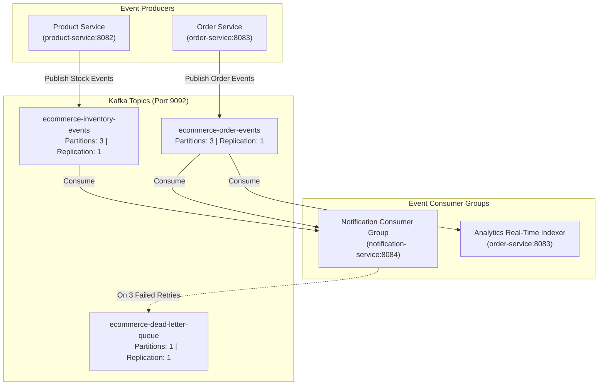

# Universal Commerce Platform (UCP) — Event Catalog & Asynchronous Messaging

## 1. Event Streaming Architecture

The platform uses Apache Kafka (Confluent Platform 7.4.0) on port 9092 for asynchronous event notification and inter-service decoupling.



---

## 2. Topic and Event Definitions

### 2.1 Topic: `ecommerce-order-events`

#### Event: `OrderCreated` (v1.0)
- **Producer:** `order-service`
- **Consumer(s):** `notification-service`, `analytics-group`
- **Key:** `orderId` (string)
- **Payload Schema:**
  ```json
  {
    "eventId": "evt-b472e389-9821",
    "eventType": "ORDER_CREATED",
    "version": "1.0",
    "timestamp": "2026-10-23T15:30:00Z",
    "correlationId": "cor-7a89f-23c",
    "payload": {
      "orderId": 1042,
      "userId": 101,
      "customerEmail": "customer@example.com",
      "totalAmount": 200.00,
      "discountAmount": 50.00,
      "itemCount": 2,
      "items": [
        { "productId": 1, "productName": "Wireless Headphones", "quantity": 2, "price": 100.00 }
      ],
      "shippingAddress": "100 Silicon Way, Suite 400, San Francisco, CA"
    }
  }
  ```

#### Event: `OrderStatusChanged` (v1.0)
- **Producer:** `order-service`
- **Consumer(s):** `notification-service`
- **Key:** `orderId` (string)
- **Payload Schema:**
  ```json
  {
    "eventId": "evt-c591f421-1204",
    "eventType": "ORDER_STATUS_CHANGED",
    "version": "1.0",
    "timestamp": "2026-10-23T15:35:00Z",
    "correlationId": "cor-7a89f-23c",
    "payload": {
      "orderId": 1042,
      "userId": 101,
      "customerEmail": "customer@example.com",
      "previousStatus": "PLACED",
      "newStatus": "SHIPPED",
      "trackingNumber": "TRK-98214958",
      "carrier": "FedEx Express"
    }
  }
  ```

---

### 2.2 Topic: `ecommerce-inventory-events`

#### Event: `LowStockDetected` (v1.0)
- **Producer:** `product-service`
- **Consumer(s):** `notification-service` (Staff Alerts)
- **Key:** `productId` (string)
- **Payload Schema:**
  ```json
  {
    "eventId": "evt-a189f712-4412",
    "eventType": "LOW_STOCK_DETECTED",
    "version": "1.0",
    "timestamp": "2026-10-23T15:30:05Z",
    "payload": {
      "productId": 1,
      "productName": "Wireless Headphones",
      "currentStock": 3,
      "reorderThreshold": 10
    }
  }
  ```

---

## 3. Idempotency & Failure Recovery

1. **Transactional Outbox & Commit Order:**
   Producers write domain records and the event to the database in a single transaction. Events are emitted to Kafka only after database commit confirmation.
2. **Consumer Idempotency:**
   Consumers maintain an idempotency check against `eventId` in `notification_db.processed_events`. If an event with the same `eventId` is delivered twice, the consumer acknowledges the offset and skips redundant processing.
3. **Dead Letter Queue (DLQ):**
   If a consumer fails to process a message due to an unrecoverable exception or third-party outage:
   - It performs up to 3 retries with exponential backoff (`1s`, `2s`, `4s`).
   - If all retries fail, the payload and stack trace are forwarded to `ecommerce-dead-letter-queue` for operator replay.
