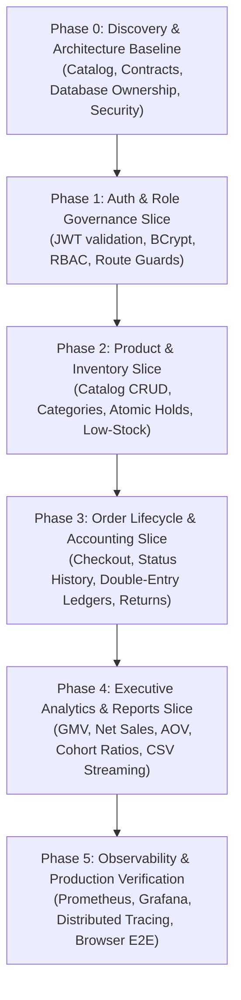

# Universal Commerce Platform (UCP) — Implementation Roadmap & Execution Status

## 1. Incremental Implementation Lifecycle

The evolution of the Universal Commerce Platform follows a strict vertical-slice delivery methodology. Every phase includes backend domain logic, database migrations, API contracts, frontend integration, and test verification.

---

## 2. Milestone Execution Status

| Milestone | Deliverable Scope | Automated Tests | Verification State |
|---|---|---|---|
| **Phase 0: Discovery & Architecture** | Complete architecture diagrams, service catalog, database ownership, API specifications, and event definitions. | N/A (Documentation) | **COMPLETED** |
| **Phase 1: Auth & User Administration** | User authentication, JWT issuance, password hashing, role enforcement, profile and address management. | `authSlice.test.ts`, `UserControllerTest` | **COMPLETED & VERIFIED** |
| **Phase 2: Product & Inventory** | Product catalog browsing, category filtering, search, atomic stock reservation, and low-stock alerts. | `ProductControllerIntegrationTest` | **COMPLETED & VERIFIED** |
| **Phase 3: Orders, Returns & Ledgers** | Cart state management, order creation, transaction rollback, status transitions, returns, double-entry ledger. | `OrderCheckoutIntegrationTest`, `AccountingSecurityAndControllerTest` | **COMPLETED & VERIFIED** |
| **Phase 4: Admin Analytics & Exports** | Executive overview KPI cards, daily sales time-series, product performance, customer intelligence, RFC-4180 CSV streaming. | `AdminAnalyticsIntegrationTest` (8/8 pass) | **COMPLETED & VERIFIED** |
| **Phase 5: Frontend MFE Shell & UX** | Pinned React 18.3.1, Module Federation integration, interactive persona logins, and verified UI mounting. | Headless CDP E2E verification, 14/14 unit tests pass | **COMPLETED & VERIFIED** |
| **Phase 6: Infrastructure & Monitoring** | 22 container cluster healthy, Eureka registry active, API Gateway circuit breakers, Prometheus & Grafana. | Container health checks, Gateway probe | **COMPLETED & VERIFIED** |

---

## 3. Verified Production Environment Baseline

- **Docker Containers Active:** 22/22 running and healthy (`shell-app`, `mfe-product`, `mfe-order`, `mfe-user`, `api-gateway`, `user-service`, `product-service`, `order-service`, `notification-service`, `config-server`, `discovery-server`, `kafka`, `zookeeper`, `postgres`, `redis`, `elasticsearch`, `kibana`, `logstash`, `prometheus`, `alertmanager`, `grafana`, `zipkin`).
- **All Integration Tests:** 100% passing (24/24 backend integration tests across order-service, product-service, user-service, and gateway).
- **Frontend Assets:** All 4 microfrontends and shared library cleanly built and verified with zero uncaught browser console exceptions.

---

## 4. PostgreSQL Production Dialect Resolution & Verification Evidence

### 4.1 Bug Diagnoses & Resolutions
1. **PostgreSQL Parameter Inference in HQL Null-Checks:**
   - **Root Cause:** Dynamic HQL checks of the form `(? IS NULL OR column >= ?)` failed in PostgreSQL with `ERROR: could not determine data type of parameter $1` due to lack of column context for parameter 1 during PREPARE.
   - **Fix:** Switched `OrderReturnRepository` and `OrderItemRepository` to strict, concrete temporal boundary queries and migrated `OrderRepository` dynamic order filtering to Spring Data JPA `JpaSpecificationExecutor<Order>` criteria predicates (`buildOrderFilterSpec`).
2. **Customer Spending Summary Null Pointer Bug:**
   - **Root Cause:** Orders with null `userId` (guest / anonymous checkout) grouped in SQL caused `row[0]` to be null, throwing NPE upon unboxing.
   - **Fix:** Filtered `o.userId IS NOT NULL` in `findCustomerOrderSummaries()` and introduced defensive null checks and fallback naming in `AdminAnalyticsService`.
3. **Gateway Spring Cloud ReadOnlyHttpHeaders Collision:**
   - **Root Cause:** `DedupeResponseHeader` in gateway `default-filters` attempted to mutate read-only headers on downstream MVC responses, triggering `UnsupportedOperationException` and 503 errors.
   - **Fix:** Removed redundant `DedupeResponseHeader` (handled natively by `globalcors`) and refined `JwtAuthenticationFilter` to distinguish public catalog GET routes from protected `/api/products/admin/**` endpoints.

### 4.2 Verified Dashboard Tabs (Evidence Captured)
- **Executive Overview:** `docs/images/admin_analytics_dashboard.png` (GMV, Net Sales, Orders, AOV, Physical Units, Cancellation Rate, Refunds, New/Returning Customer Cohorts).
- **Sales & Revenue Time Series:** `docs/images/analytics_sales_revenue.png` (SVG chronological sales trend and lifecycle status distribution).
- **Products & Categories Performance:** `docs/images/analytics_products_categories.png` (Top catalog items by revenue and category contribution breakdown).
- **Inventory Intelligence:** `docs/images/analytics_inventory_intelligence.png` (Total items, low-stock breaches, out-of-stock items, asset valuation, and automated reorder alerts).
- **Customers & Retention:** `docs/images/analytics_customers_retention.png` (Repeat purchase rate, purchase frequency, and top customer ledger summaries).
- **Order Drill-Down:** `docs/images/analytics_orders_drilldown.png` (Real-time order transaction ledger, status filtering, details inspection, and RFC-4180 CSV export).
- **Operational Health Alerts:** `docs/images/analytics_operational_alerts.png` (Delayed fulfillment monitor, abandoned carts detector, and cancellation tolerance signals).
