# Universal Commerce Platform (UCP) — Security Architecture

## 1. Zero-Trust Security Model

The Universal Commerce Platform enforces a defense-in-depth, Zero-Trust security model. Every inbound HTTP request is authenticated, sanitized, and authorized at both the Edge Gateway and each individual downstream microservice.

```mermaid
flowchart TD
    Client["Client Browser"] -->|1. Request with Bearer JWT| Nginx["Nginx Ingress / Ports 3000-3003"]
    Nginx -->|2. Proxy Request| Gateway["Spring Cloud Gateway (:8080)"]

    subgraph EdgeSecurity["Edge Security Boundary"]
        Gateway -->|3. Extract & Validate JWT Signature| JWTValidator["HMAC-SHA256 JWT Validator"]
        JWTValidator -->|4. Inject Trusted Headers| HeaderInjector["Inject X-User-Id, X-User-Role"]
    end

    HeaderInjector -->|5. Forward with Context Headers| OrderService["order-service (:8083)"]
    HeaderInjector -->|5. Forward with Context Headers| ProductService["product-service (:8082)"]
    HeaderInjector -->|5. Forward with Context Headers| UserService["user-service (:8081)"]

    subgraph ServiceSecurity["Service Security Boundary"]
        OrderService -->|6. Authorize @PreAuthorize / assertRole| RoleGuard["assertManagerOrAdmin(role)"]
        RoleGuard -->|7. Verified Access| BusinessLogic["Execute Business Logic & Aggregation"]
    end
```



---

## 2. Authentication & JWT Architecture

- **Token Format:** Signed JSON Web Tokens (JWT) according to RFC-7519.
- **Algorithm:** `HS256` (HMAC with SHA-256) using a 256-bit secure master secret configured outside source code via environment variable `JWT_SECRET`.
- **Payload Schema:**
  ```json
  {
    "sub": "admin@ecommerce.com",
    "id": 1,
    "email": "admin@ecommerce.com",
    "name": "Platform Admin",
    "role": "ADMIN",
    "iat": 1792747200,
    "exp": 1792833600
  }
  ```
- **Password Hashing:** Passwords in `user_db` are encrypted using **BCrypt** with an adaptive work factor of 12 rounds. Raw passwords are never stored, logged, or exposed over APIs.

---

## 3. Role-Based Access Control (RBAC)

The platform enforces three distinct authorization tiers:

| Role | Permissions & Scope |
|---|---|
| **ADMIN** | Full governance: User role mutation, system configuration, all customer orders, ledgers, analytics, and operational anomaly management. |
| **MANAGER** | Operational scope: Catalog merchandising, order fulfillment, refund approvals, and business analytics. Cannot promote users to Admin. |
| **USER** (Customer) | Restricted scope: View public catalog, manage own cart, checkout own orders, view own order history, and own address book. Strictly prevented from accessing `/api/*/admin/**` endpoints. |

### Server-Side Boundary Enforcement
Frontend route guards (`ProtectedRoute`, `RoleGuard`) provide UI convenience and feedback, but **the backend is the authoritative security boundary**.
Every administrative endpoint verifies the calling role:
```java
private void assertManagerOrAdmin(String role) {
    if (role == null || (!role.toUpperCase().contains("ADMIN") && !role.toUpperCase().contains("MANAGER"))) {
        log.warn("Security Alert: Unauthorized access attempt to Admin resource by role: {}", role);
        throw new ResponseStatusException(HttpStatus.FORBIDDEN, "Access denied: Staff authorization (Manager or Admin) required.");
    }
}
```

---

## 4. OWASP Top 10 Defenses

1. **SQL Injection:**
   All persistence operations use Spring Data JPA / Hibernate with prepared statements and typed parameters. Raw SQL concatenation is forbidden.
2. **Broken Object Level Authorization (IDOR):**
   Endpoints accepting `userId` (e.g. `/api/orders/user/{userId}`) cross-reference `X-User-Id` with the path variable. A customer cannot query another user's orders unless they hold `ADMIN` or `MANAGER` credentials.
3. **CSV Formula Injection Mitigation:**
   In [`AdminAnalyticsController.java`](file:///d:/practical/ecommerce-platform/backend/order-service/src/main/java/com/ecommerce/order/controller/AdminAnalyticsController.java#L101-L115), streamed CSV reports sanitize cell values starting with `=`, `+`, `-`, or `@` by prepending a single quote (`'`), preventing malicious code execution in Microsoft Excel and Google Sheets.
4. **Cross-Site Scripting (XSS):**
   Content-Security-Policy and `X-XSS-Protection: 1; mode=block` headers are injected at Nginx and API Gateway levels. React's JSX automatically escapes dynamic values.
5. **Cross-Site Request Forgery (CSRF):**
   Stateless Bearer JWTs are transmitted in the `Authorization` header rather than ambient cookies, naturally mitigating CSRF vulnerabilities.
