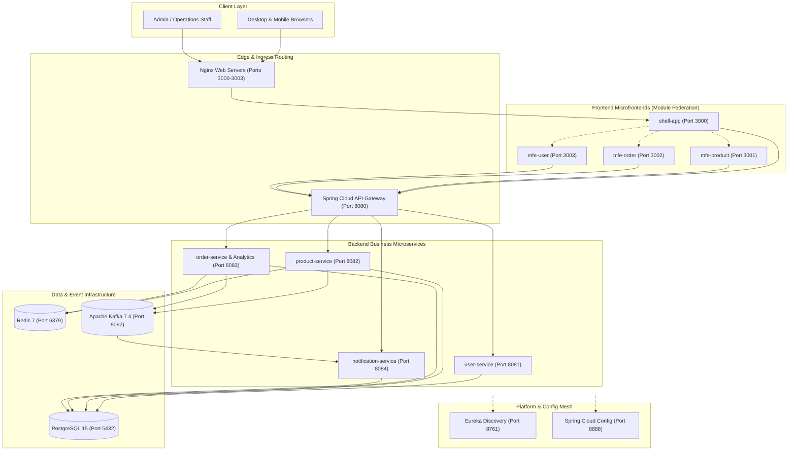
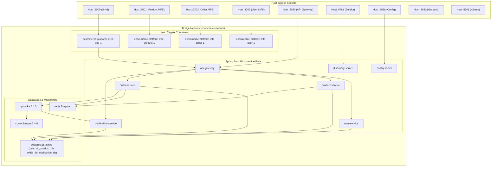
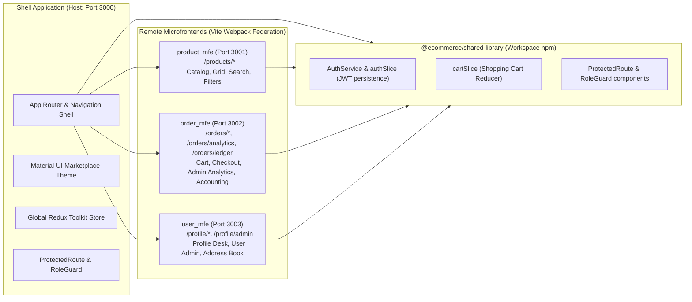
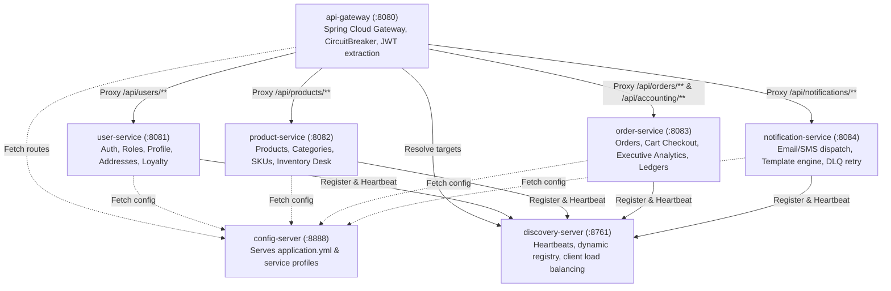
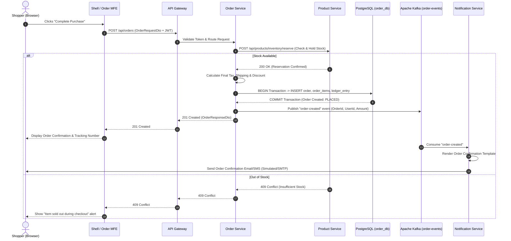
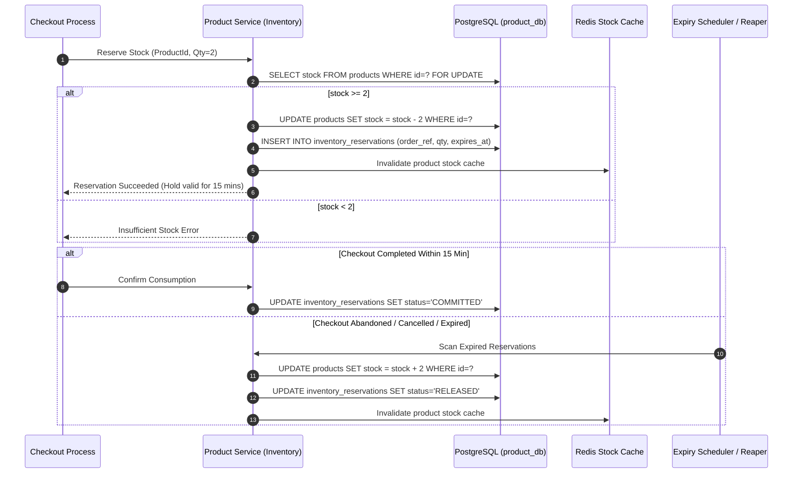
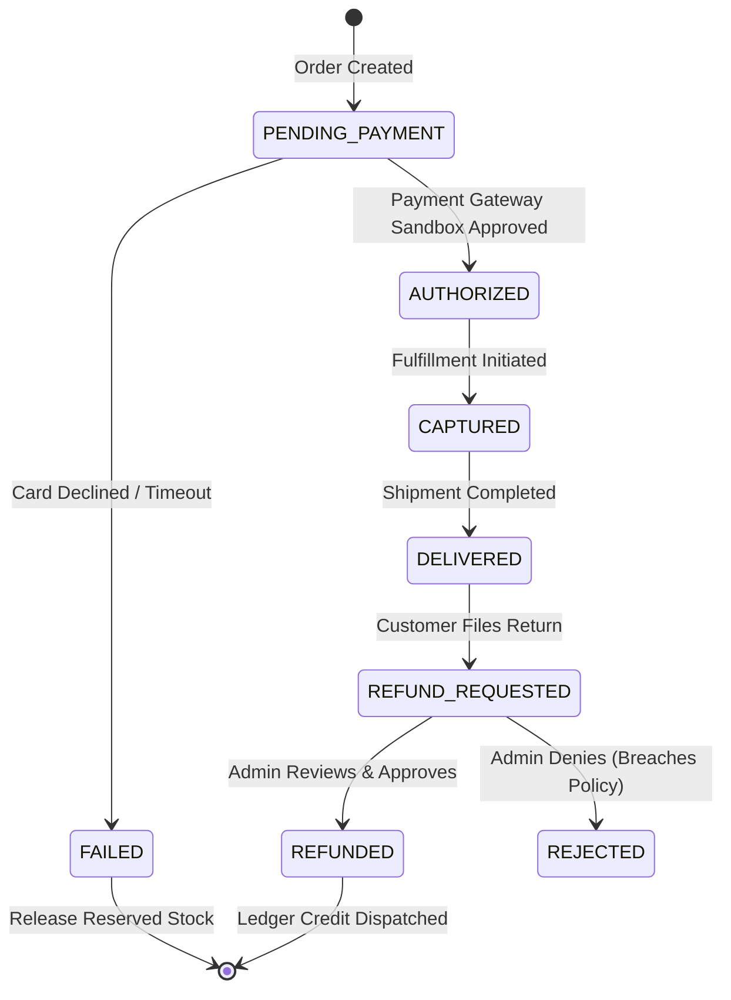
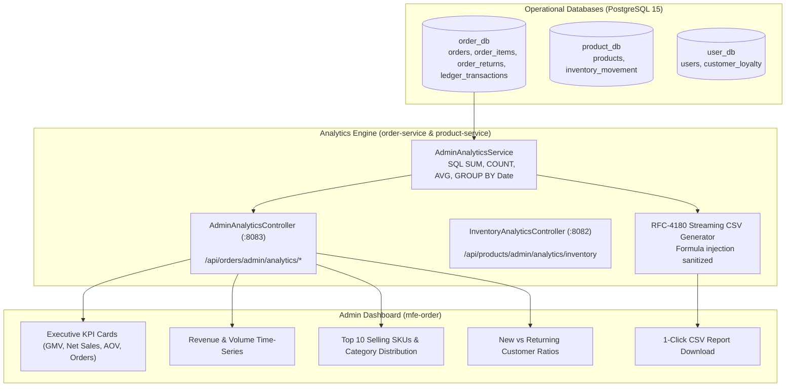
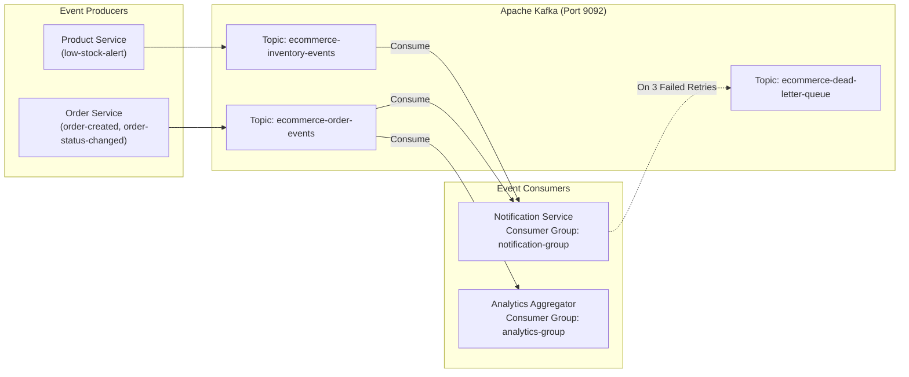

# Universal Commerce Platform (UCP) — System Architecture

## 1. Executive Summary & Architecture Overview

The Universal Commerce Platform (UCP) is an enterprise-grade, single-store e-commerce platform architected as a decoupled distributed system. It utilizes Spring Boot 3 microservices on the backend, React 18 microfrontends (Module Federation) on the frontend, PostgreSQL for relational storage, Redis for distributed caching, Apache Kafka for asynchronous domain events, and an enterprise observability stack (Prometheus, Grafana, Zipkin, ELK Stack).

---

## 2. Container and Deployment Architecture

The entire platform is containerized using Docker and multi-stage builds. In local and staging environments, Docker Compose coordinates 22 containers across isolated networks. In production, Kubernetes manifests and Istio service mesh enforce Zero-Trust network policies and mTLS.

---

## 3. Frontend Microfrontend Architecture (Module Federation)

The frontend is partitioned into independent Vite + TypeScript applications orchestrated via `@originjs/vite-plugin-federation` and pinned to React 18.3.1.

---

## 4. Backend Service Dependencies & Discovery

All services bootstrap by querying `config-server` on port 8888, register their dynamic network locations with `discovery-server` (Netflix Eureka) on port 8761, and expose CircuitBreakers via Resilience4j.

---

## 5. Order Placement Sequence

The checkout workflow coordinates stock reservations, payment authorization (simulated sandbox or real provider), transactional database commit, and asynchronous event streaming.

---

## 6. Inventory Reservation and Release Workflow

To prevent overselling under high concurrency, stock checks and reservations are isolated and atomic.

---

## 7. Payment, Refund, and Accounting Lifecycle

Transactions are recorded in a double-entry style accounting ledger inside `order_db`.

---

## 8. Analytics Data Flow

Executive analytics, daily time series, cohort intelligence, and CSV export streaming run server-side database aggregations without cross-database join violations.

---

## 9. Kafka Event Flow and Failure Recovery

Kafka decouples asynchronous operations with dead-letter queues (DLQ) and exponential backoff retry policies.

