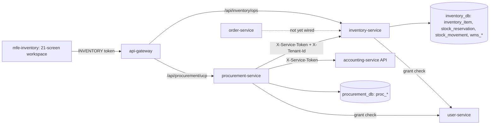
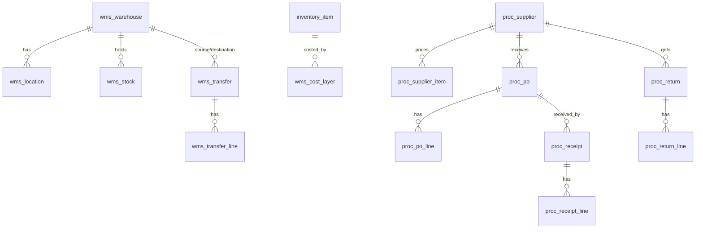

# Inventory & Procurement Management

Status: partial. See [VERIFICATION_REPORT.md](VERIFICATION_REPORT.md) for what is proven, partial and not done.
Related: [API.md](API.md), [BUSINESS_RULES.md](BUSINESS_RULES.md).

## 1. Repository assessment (what existed)

| Area | Finding |
|---|---|
| `inventory-service` (8085, `inventory_db`) | Tenant-scoped (JWT `application_code=INVENTORY`, `tenant_id`, grant re-check with user-service). Tables `inventory_item`, `stock_reservation`, `stock_movement`, `back_in_stock_alert`. Reservation was read-modify-write (oversell risk), no idempotency, no warehouses/transfers/batches/valuation. `@Scheduled` reservation expiry never ran because `@EnableScheduling` was missing. |
| `stock-service` | Legacy product-level stock. `order-service` still deducts stock here (`/api/stock/adjustments`). Not changed. |
| `procurement-service` (8093, `procurement_db`) | Single-tenant, `/api/**` permitAll behind the gateway, no tests. Legacy suppliers, POs, receipts, invoices. Left untouched. |
| `accounting-service` | Only `/internal/accounting/supplier-payables`; no credit-note path. |
| Frontend | `mfe-inventory` (catalog page), `mfe-procurement` (single legacy page), shell menu entry "Inventory". |
| user-service | Permission migrations V1-V12. |

## 2. Existing vs missing, and what was done

| Capability | Before | Now |
|---|---|---|
| Availability = on-hand - reserved - unavailable | no `unavailable` | done (`Availability`, `InventoryItem.getAvailableQuantity`) |
| Incoming never available until accepted | no concept | done (`incoming_quantity`, excluded from availability) |
| Warehouses, locations, per-warehouse stock | none | done (`wms_warehouse`, `wms_location`, `wms_stock`) |
| Stock transfers with state machine | none | done (all 13 states modelled, UI actions for each step) |
| Adjustments with before/after, reason, evidence, approval | direct overwrite | done (threshold approval, different approver, idempotent) |
| Atomic reservation, idempotency, partial/backorder, release | racy | done (conditional UPDATE, idempotency key, `allowPartial`) |
| Order Service integration | calls stock-service | **not switched**: internal reservation API exists (`/internal/inventory/reservations`) but order-service does not call it yet |
| Suppliers, onboarding/approval, catalog, performance | legacy single-tenant | done in new tenant-scoped tables `proc_*` |
| Purchase orders full lifecycle, totals, document | legacy | done (DRAFT..RECEIVED, REJECTED, CANCELLED, derived OVERDUE, tax/discount/shipping, HTML document download) |
| Goods receiving, partial/damaged/rejected, batch/expiry/serial, idempotent | legacy | done except inspection workflow (note field only) |
| Supplier returns + Accounting | none | done via new accounting credit-note API (two-step ship then credit) |
| Replenishment (reorder point, draft PO only) | legacy low-stock only | done (forecast + draft conversion) |
| Forecasting from real history | none | done (velocity, coverage, dead/slow stock, stockout risk) |
| Valuation FIFO + weighted average + reconciliation | cost_price only | done (cost layers; uncosted units reported, not hidden) |
| Cycle counting, stock audits | none | simplified: counts become audited adjustments; audit screen is the audit log. No count sessions/blind counts |
| Restaurant ingredient inventory | none | not done (unit conversion maths only) |
| CSV import, bulk ops with approval, variant-level | partial legacy | CSV export only (new); legacy catalog CSV import untouched; bulk ops and variant-level not done |
| Notifications (10 alert types) | none | not done; only `ADJUSTMENT_PENDING` event is published, no consumer |
| 17 permissions | none | migration V13 + backend enforcement + gateway coarse gate |

## 3. Architecture



Receiving flow: PO issued (incoming +qty) -> receipt (accepted/rejected/damaged) -> procurement records receipt -> inventory `/internal/inventory/receipts` adds accepted qty and a FIFO cost layer, idempotent on `sourceRef` -> `incoming` reduced.

## 4. ERD (new tables)



All tables carry `tenant_id`. Prefixes `wms_` and `proc_` avoid collisions in shared databases (the legacy `suppliers`, `purchase_orders`, `stock_*` tables are untouched). Migrations: inventory `V4__inventory_operations.sql`, procurement `V2__tenant_procurement.sql`, user-service `V13__inventory_procurement_permissions.sql`, accounting has no migration (new endpoint only).

## 5. Deployment

```bash
cd backend && ./mvnw -pl inventory-service,procurement-service,accounting-service,user-service,api-gateway package -DskipTests
cd ../frontend && npm run build --workspace=mfe-inventory && npm run build --workspace=shell-app
cd .. && docker compose up -d --build inventory-service procurement-service accounting-service user-service api-gateway mfe-inventory shell-app
```

Requirements: `.env` must define `JWT_SECRET` and `SERVICE_TO_SERVICE_TOKEN` (compose refuses to start without them). Flyway applies the migrations on start. Procurement reads `services.inventory.url` and `identity.service.url` from `config-repo/procurement-service-docker.yml`; restart config-server after changing it.

## 6. Admin guide

1. Assign roles: INVENTORY_MANAGER, WAREHOUSE_OPERATOR, PROCUREMENT_MANAGER, PROCUREMENT_OFFICER, INVENTORY_ANALYST (V13) through the tenant's application grants.
2. Create warehouses and bins (Warehouse Management), then receive stock through a PO so cost layers exist.
3. Onboard suppliers (PENDING), approve (supplier:manage), set catalog prices, create POs (draft), submit, approve by a different user, issue, receive.
4. Adjust stock only through Stock Adjustments / Cycle Counting; changes above the threshold (Configuration, default 20 units) need a second approver.
5. Transfers: draft, request, approve (different user, reserves source), pick, dispatch (source decremented), receive (destination incremented by accepted qty only).
6. Forecasting and Valuation are read-only reports. Valuation lists "uncosted units" (opening balances without cost layers).
