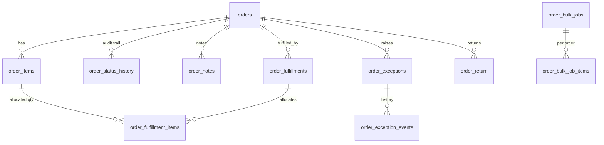
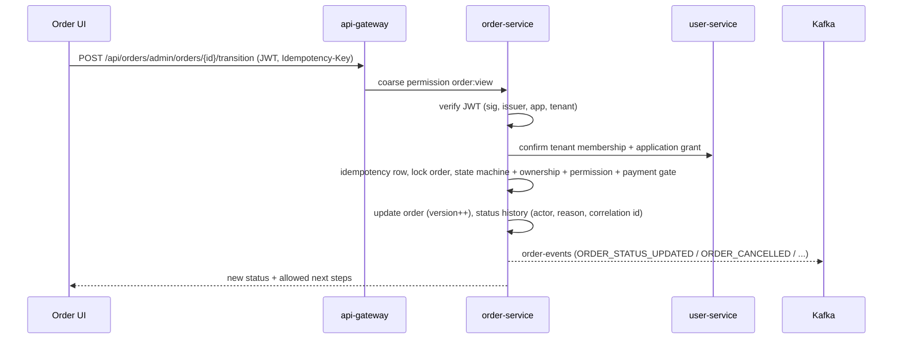

# Order Management Control Tower (E-commerce Admin)

Extends the **existing order-service** (no new service). UI: `frontend/mfe-order/src/control`, menu **Operations → Order Management** (`/orders/control`).

## 1. Repository assessment — before this work

| Area | What existed | Gap |
|---|---|---|
| Orders | `orders`/`order_items` (user, status string, total, discount, coupon, carrier, tracking, shippingStatus), tracking events, returns (+items), cart, coupons, Kafka `order-events`, delivery-progress callback (`/internal/order-data/{id}/delivery-status`), executive analytics | **No tenant/store/vendor columns**; `GET /api/orders` returned every order in the database |
| Security | `permitAll` on `/api/orders/**`; trusted gateway headers | No JWT verification, no per-tenant authorisation |
| Lifecycle | Free-text `status`; `PUT /{id}/status` accepted **any** string (an existing test moved PLACED→SHIPPED) | No state machine, no history, no actor/reason |
| Returns | Admin "REFUND" set the return to `REFUNDED` immediately | Refund state not owned by Payment/Accounting |
| Notifications | Consumer keyed by `ORDER-{id}-{eventType}` | Every status update after the first for an order was silently dropped as a "duplicate" |
| Payment | **No payment service exists in the repo** | Payment/refund integration can only be a callback contract |
| Restaurant | Nothing | No restaurant order concept or catalogue service |

## 2. What was added

| Concern | Where |
|---|---|
| Schema | `order-service/.../V8__order_control_tower.sql` (new): extends `orders`, `order_items`; adds `order_status_history`, `order_admin_actions` (idempotency), `order_notes`, `order_fulfillments`, `order_fulfillment_items`, `order_exceptions`, `order_exception_events`, `order_settings`, `order_bulk_jobs`, `order_bulk_job_items`, `order_saved_views`, `order_processed_events` |
| Auth | `admin/security/*` — verifies JWT signature/issuer/audience/`application_code=ECOMMERCE_ADMIN` and the live tenant grant itself; tenant and store scope come only from the token |
| State machine | `OrderStateMachine` (retail + restaurant tables, system-only / delivery-owned / fulfillment-driven targets), `SlaCalculator` |
| Services | `OrderQueryService` (search/export), `OrderAdminService` (transitions, idempotency, payment/refund callbacks, details, timeline, audit), `FulfillmentService`, `ExceptionService`, `BulkService`, `OrderReportService`, `OrderSettingsService`, `OrderMiscService` |
| APIs | `OrderAdminController` `/api/orders/admin/**`; `InternalOrderEventsController` `/internal/order-events/{payment,refund,return-refund}` (service token) |
| Hardened legacy | `PUT /api/orders/{id}/status` and cancel now use the state machine + history; return refunds wait for confirmation; notification idempotency fixed |
| Permissions | `user-service/.../V11__order_management_permissions.sql`; gateway coarse gate `/api/orders/admin/** → order:view` |

## 3. Lifecycles

Retail: `CREATED → PAYMENT_PENDING → PAYMENT_CONFIRMED → CONFIRMED → PROCESSING → READY_FOR_FULFILLMENT → PARTIALLY_FULFILLED → FULFILLED / SHIPPED → OUT_FOR_DELIVERY → DELIVERED`, plus `ON_HOLD`, `CANCELLATION_REQUESTED`, `CANCELLED`, `PAYMENT_FAILED`, `FULFILLMENT_FAILED`, `DELIVERY_FAILED`, `RETURN_REQUESTED`, `REFUND_PENDING`, `REFUNDED` (exact table: `GET /api/orders/admin/meta`). Legacy `PLACED`/`PENDING`/`PENDING_INVENTORY` are accepted aliases.
Restaurant: `RECEIVED → ACCEPTED → PREPARING → READY_FOR_PICKUP → PICKED_UP → DELIVERED`, plus `REJECTED`, `PREPARATION_DELAYED`, `CANCELLED`, `PICKUP_FAILED`. Restaurant orders have no warehouse/fulfillment steps.

Ownership rules enforced in code: `PAYMENT_CONFIRMED/PAYMENT_FAILED/REFUND_PENDING/REFUNDED` are set only by payment/refund callbacks; `PARTIALLY_FULFILLED/FULFILLED` only by recording fulfillments; `OUT_FOR_DELIVERY/DELIVERED/DELIVERY_FAILED/PICKED_UP` belong to the Delivery service whenever the order has a delivery reference. Shipped goods cannot be cancelled (use returns).

## 4. ERD

`order_settings` (SLA thresholds per tenant/store), `order_saved_views` (per user), `order_admin_actions` (idempotency keys) and `order_processed_events` (inbound event de-duplication) stand alone. Every table carries `tenant_id`; `orders.version` is the optimistic lock.

## 5. Sequence — administrative transition

## 6. Deploy / configuration
1. Deploy `user-service` (V11), then `order-service` (V8; needs `JWT_SECRET`, `SERVICE_TO_SERVICE_TOKEN`, `IDENTITY_SERVICE_URL` — set in compose), `notification-service`, `api-gateway`, frontend (`mfe-order`, shell).
2. Existing orders are assigned to the legacy tenant `00000000-0000-4000-8000-000000000001`. New checkouts use `pricing.integration.tenant-id` when the pricing integration is on, otherwise the legacy tenant — **checkout has no tenant context yet** (see report).
3. Tune per-tenant SLA thresholds in **Order Settings**. The exception scan runs every 5 minutes (`orders.exceptions.scan-delay-ms`).
4. `orders.returns.require-refund-confirmation` (default `true`): return refunds stay `REFUND_PENDING` until `/internal/order-events/return-refund` confirms. Set `false` only for deployments with no payment integration (restores the old immediate behaviour).
5. A Payment Service (not in this repo) must call `/internal/order-events/payment`, `/refund` and `/return-refund` with `X-Service-Token` and `X-Tenant-Id`.

Docs: [API](API.md) · [Administrator guide](ADMIN_GUIDE.md) · [Verification report](VERIFICATION_REPORT.md)
