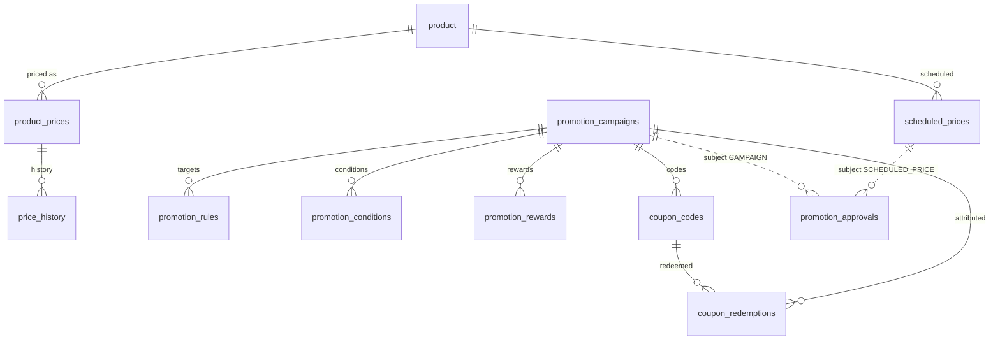

# Pricing & Promotions (E-commerce Admin)

Tenant-scoped price management, promotion campaigns, coupons and server-side discount calculation.

**No new service.** The module lives in `product-service` (package `com.ecommerce.product.pricing`) because that service already
owns the tenant-scoped catalog admin API, the E-commerce Admin JWT/application-grant filter (`CatalogTenantAuthenticationFilter`)
and the product/cost data. The UI lives in `frontend/mfe-product/src/pricing` and is reached from the shell menu
**Operations → Pricing & Promotions** (`/products/pricing`).

| Concern | Where |
|---|---|
| Schema | `backend/product-service/src/main/resources/db/migration/V7__pricing_and_promotions.sql` (new; V1-V6 untouched) |
| Permissions/roles | `backend/user-service/src/main/resources/db/migration/V9__pricing_promotions_permissions.sql` |
| Admin API | `PricingAdminController` → `/api/products/admin/pricing/**` (JWT + application grant + per-endpoint permission) |
| Checkout API | `InternalPricingController` → `/internal/pricing/{quote,redeem,reverse/{orderRef}}` (service token, not routed by the gateway) |
| Calculation | `DiscountEngine` (pure), `QuoteService` (loads prices/campaigns, redeems atomically) |
| Gateway | `JwtAuthenticationFilter.routePermission`: `/api/products/admin/pricing/**` needs `pricing:read` (coarse); the service checks the exact permission |
| Order integration | `order-service` `PricingClient` + `OrderService.placeOrder` (off by default, see Deploy) |

## ERD

Every table carries `tenant_id` (and `store_id` where stores matter; `'*'` = all stores). Mutable tables carry
`version`, `created_by/at`, `updated_by/at`. `pricing_settings` (one row per tenant/store) holds the validated policy;
`promotion_audit_logs` is the audit trail; `promotion_order_applications` (an addition to the brief) makes redemption idempotent per order.
Child tables (rules/conditions/rewards/coupons/redemptions) reference the campaign by FK and repeat `tenant_id`; all queries filter on it.

Constraints worth knowing: `ux_product_price_scope (tenant, store, product, variant, currency)`, `ux_coupon_tenant_code (tenant, code)`,
`ux_redemption_order (tenant, coupon, order_ref)`, `promotion_order_applications PK (tenant, order_ref)`, CHECKs for positive prices,
sale ≤ base, date windows, limit positivity, status enums and discount percent ranges.

## Deploy / configuration

1. Deploy `user-service` first (V9 adds the permission keys and the roles `PRICING_MANAGER`, `PRICING_APPROVER`, `MARKETING_MANAGER`, `PRICING_ANALYST`; `ADMIN` receives all). Grant roles to tenant members through the existing tenant-access flow.
2. Deploy `product-service` (Flyway applies V7). It needs the existing `JWT_SECRET`, `SERVICE_TO_SERVICE_TOKEN` and `IDENTITY_SERVICE_URL`. Optional `pricing.scheduler.delay-ms` (default 60000) controls how often approved scheduled prices are applied.
3. Deploy `api-gateway` (new coarse route permission).
4. Deploy the frontend shell and `mfe-product`.
5. **Checkout integration (optional, off by default).** order-service has no tenant column, so one tenant is configured per deployment:
   `pricing.integration.enabled=true`, `pricing.integration.tenant-id=<tenant uuid>`, `pricing.integration.currency=USD`, `services.product.url=http://product-service:8082`
   (Spring relaxed binding: env vars `PRICING_INTEGRATION_ENABLED`, `PRICING_INTEGRATION_TENANT_ID`, …). order-service V7 adds `orders.promotion_ref`.
   When enabled, cart-supplied prices are ignored; unit prices, discounts and the payable total are computed by product-service, and the legacy global coupon table is bypassed.
6. Tenant policy defaults (max discount 50%, min margin 0%, approval threshold 20%, 14-day campaigns, 1000 bulk coupons, 5 uses per customer, `FLAGGED_ONLY` stacking, USD/EUR/GBP/INR) apply until a tenant saves **Pricing Rules**.

Rollback: V7 only adds tables; dropping them (reverse FK order) removes the module. Set `pricing.integration.enabled=false` to return checkout to legacy behaviour.

Docs: [API](API.md) · [Business rules](BUSINESS_RULES.md) · [RBAC](RBAC.md) · [Verification report](VERIFICATION_REPORT.md)
