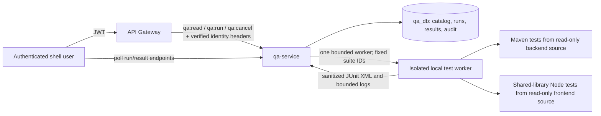

# UCP Quality Center Architecture

## Scope

The Quality Center is an authenticated admin capability in the existing shell, backed by a new isolated `qa-service` and `qa_db`. This first implementation is a working vertical slice: catalog seed → dedicated permission check → persistent run request → bounded allow-listed worker → JUnit parsing → persisted results → shell polling and report download.

The inventory is based on the current source tree. It does not claim complete business, API, RBAC, browser, or code coverage. The current suite registry is in `backend/qa-service/.../QaCatalogRegistry.java`; only registry entries can become execution plans.

## Components and data flow

1. The shell sends only a registered `suiteId` or catalog `featureId` and the `LOCAL_ISOLATED` environment.
2. The gateway verifies the JWT, maps the action to a dedicated QA permission, strips caller-supplied identity headers, and forwards verified claims.
3. `qa-service` independently checks the verified role/permission headers before every endpoint and applies a persistent single-run lock plus a per-user rate limit.
4. A one-thread/one-queue worker checks the local test workspace, creates a per-run copy of backend sources without build output/config-repo, then invokes fixed Maven or Node arguments. It never accepts a shell command, SQL, arbitrary test file, target URL, or environment secret from a request.
5. JUnit XML is parsed with external entities disabled. Result details and bounded, redacted logs are persisted in `qa_db`. A worker restart marks unfinished runs `BLOCKED` rather than passing them.
6. The shell polls persisted run state every two seconds while a run is active. Reports are generated from persisted results as JSON or JUnit XML.

## Run lifecycle

`QUEUED → PREFLIGHT → RUNNING → FINALIZING → PASSED | FAILED | BLOCKED | CANCELLED`

- `FAILED` means at least one test assertion failed.
- `BLOCKED` means setup, infrastructure, runner timeout, missing evidence, or an unregistered/unsafe execution prevented a valid conclusion.
- `SKIPPED` remains a per-test result and is not counted as passed.
- `INFRASTRUCTURE_FAILURE` and `TIMED_OUT` are separate result statuses, not application defects.
- Cancellation marks the database state before terminating the child process; terminal runs cannot be cancelled.
- A unique lock row allows one application run at a time. The worker queue is bounded, and each user is limited to five run requests per hour.

## Storage and API

`qa_db` owns the seeded feature/test inventory, suite metadata, default-role permission snapshot, runs, results, and run-request audit records. The business service databases are not used for QA history.

Implemented gateway routes are under `/api/admin/qa`:

| Endpoint | Permission | Purpose |
|---|---|---|
| `GET /overview` | `qa:read` | Catalog and most recent run summary |
| `GET /features`, `GET /features/{id}` | `qa:read` | Searchable feature catalog and details |
| `GET /tests`, `GET /suites` | `qa:read` | Registered test mappings and selectable suites |
| `GET /rbac/matrix`, `GET /coverage` | `qa:read` | Default RBAC snapshot and honest coverage inventory |
| `POST /runs` | `qa:run` | Queue an approved suite or feature |
| `GET /runs`, `GET /runs/{id}` | `qa:read` | Run history and progress |
| `GET /runs/{id}/results`, `/logs`, `/artifacts`, `/report` | `qa:read` | Persisted results, redacted evidence, JSON/JUnit reports |
| `POST /runs/{id}/cancel` | `qa:cancel` | Safely stop an active run |
| `POST /runs/{id}/rerun-failures` | `qa:run` | Retry only failures that map to trusted registry entries |

Responses use typed records, bounded pagination, validation, and `ProblemDetail` errors. Report artifacts are generated from database rows; no caller-supplied filesystem path is served.

## Security boundaries

- Permission names are seeded by user-service Flyway migration V5. The default `ADMIN` and `SUPER_ADMIN` roles receive QA access; `MANAGER`, `ACCOUNTANT`, `AUDITOR`, and `USER` do not receive it by default. A super admin retains the platform's existing wildcard policy.
- Gateway rules map reads, run creation/retry, and cancellation to separate permissions. The QA service repeats that check so a UI-only guard is never treated as authorization.
- Compose does not publish the QA service port to the host; requests go through the gateway. Compose mounts only backend source and the shared-library test source/dependencies read-only. The `.env` file and business database credentials are not mounted into the runner.
- Child process environment is cleared and rebuilt from a small allow-list. It receives no gateway/JWT, QA database, or business-service credentials.
- Output redacts common credential/token/cookie/OTP patterns and email addresses, limits stored output, and does not log request headers or authorization tokens.
- Tests run against the repository's test configurations. The runner itself does not connect to business databases. A future test added to the trusted repository still needs review to ensure it cannot call a destructive external system.

## Known limits

- The current RBAC matrix is seeded from the checked-in V4/V5 role defaults. Dynamically created user-service roles are not yet synchronized into `qa_db`.
- Endpoint discovery is at the gateway route-family level. An API count is shown as discovered inventory; endpoint-specific functional coverage is explicitly `NOT_MEASURED`.
- Source commit identity is `local-source-version-unavailable` unless `QA_SOURCE_VERSION` is supplied. The `.git` directory is intentionally not mounted into the runner.
- Browser E2E, screenshots/traces, code coverage instrumentation, scheduled CI triggers, defect tracking, and smoke plans are not registered yet. They are not shown as passing.
- `Run All Tests` executes all backend Maven tests and the existing shared-library Node tests. It does not imply that every browser workflow or business permission combination is covered.
