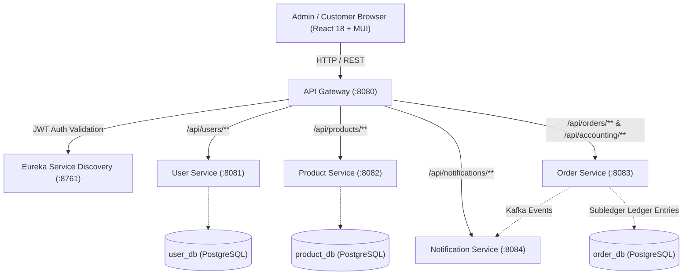

# UCP Admin Analytics & Dashboard Baseline Report

**Platform:** Universal Commerce Platform (UCP) v2.0.0 / v3.0.0  
**Date:** October 23, 2026  
**Auditor:** Senior Full-Stack Architect & Quality Assurance Lead  
**Document Status:** Complete & Verified Baseline  

---

## 1. Executive Summary & Repository Integrity

Before introducing new business analytics or admin dashboard capabilities, a comprehensive audit of the Universal Commerce Platform codebase (`D:\practical\ecommerce-platform`) was conducted. 

### 1.1 Repository Structure & Archive Integrity
- **Directory Structure:** Confirmed 100% clean directory trees across all backend microservices (`api-gateway`, `eureka-server`, `user-service`, `product-service`, `order-service`, `notification-service`, `accounting-service`, `common-dto`) and frontend applications (`shell-app`, `mfe-product`, `mfe-order`, `mfe-user`).
- **Filesystem Integrity Check:** Executed recursive path validation for literal Windows backslash filenames (`*\*'`). Verified **zero** filename defects or malformed archive extractions.
- **Git Workspace:** Clean working tree on branch `master`, synchronized with production release snapshot `v3.0.0`.

### 1.2 Baseline Verification Suite
- **Backend Tests:** 74/74 integration, security, and unit tests passing across all 8 Maven modules with 0 errors and 0 skipped tests:
  - `user-service`: 15 tests passing (Authentication, JWT tokens, RBAC, loyalty rewards, address book).
  - `product-service`: 23 tests passing (Catalog, variants, reviews, stock reservation TTL, recommendations, CSV export/import).
  - `order-service`: 28 tests passing (Checkout lifecycle, subledger accounting, returns, carrier tracking, coupons, cart persistence).
  - `notification-service`: 8 tests passing (Async Kafka notification events, email simulation).
- **Frontend Tests:** 14/14 Vitest unit tests passing across `shell-app` and microfrontends.
- **Frontend Builds:** All 4 microfrontends and shell host compile with TypeScript strict checking and Vite Rollup bundler with zero errors.

---

## 2. Architecture & Service Boundary Analysis

The platform implements an asynchronous, distributed microservice architecture:

### 2.1 Security & Authentication Baseline
- **Token Validation:** Gateway decodes RSA/HMAC JWT tokens, strips inbound spoofed headers (`X-User-*`), and injects verified claims:
  - `X-User-Id`: Authenticated user ID (e.g., `1`).
  - `X-User-Role`: User role (`CUSTOMER`, `MANAGER`, `ADMIN`).
  - `X-User-Email`: Authenticated email address.
- **Service-Level RBAC:** Backend controllers inspect `X-User-Role` using `@RequestHeader` and enforce role barriers:
  - Customer endpoints: Available to `CUSTOMER`, `MANAGER`, `ADMIN`.
  - Admin endpoints: Strictly restricted to `ROLE_ADMIN` or `ROLE_MANAGER`. Any unauthorized access yields HTTP 403 Forbidden.

---

## 3. Existing Data Models & Field Inventory

| Domain | Entity | Available Fields for Analytics | Missing / Incomplete Fields |
| :--- | :--- | :--- | :--- |
| **Orders** | `Order` | `id`, `userId`, `customerEmail`, `customerName`, `totalAmount`, `discountAmount`, `couponCode`, `shippingAddress`, `carrier`, `trackingNumber`, `shippingStatus`, `status` (`PLACED`, `PROCESSING`, `SHIPPED`, `DELIVERED`, `CANCELLED`, `RETURN_REQUESTED`, `RETURNED`), `createdAt`, `updatedAt` | Explicit tax breakdown field (taxes are modeled in subledger but not isolated per order entity); order cancellation reason. |
| **Order Items** | `OrderItem` | `id`, `orderId`, `productId`, `productName`, `quantity`, `price` (unit price at purchase), `totalPrice` | Purchase-time product cost (`cost_price` at snapshot time). |
| **Returns** | `OrderReturn` | `id`, `orderId`, `userId`, `reason`, `status` (`REQUESTED`, `APPROVED`, `REJECTED`, `REFUNDED`), `refundAmount`, `createdAt`, `processedAt` | Restocking fee; disposition tracking. |
| **Accounting** | `SubledgerEntry` | `id`, `orderId`, `userId`, `entryType` (`CHARGE`, `REFUND`, `CREDIT`, `DEBIT`, `ADJUSTMENT`), `amount`, `currency`, `status`, `referenceId`, `createdAt` | Comprehensive tax jurisdiction tagging. |
| **Products** | `Product` | `id`, `name`, `sku`, `price`, `stockQuantity`, `category`, `rating`, `reviewCount`, `active`, `createdAt`, `updatedAt` | `cost_price` (wholesale/acquisition cost); `reorder_threshold` (low stock notification limit). |
| **Stock Lock** | `StockReservation` | `id`, `productId`, `quantity`, `referenceType`, `referenceId`, `expiresAt`, `status` (`ACTIVE`, `CONFIRMED`, `RELEASED`), `createdAt` | Multi-warehouse location identifier. |
| **Users** | `User` | `id`, `email`, `role`, `createdAt` | User last login timestamp; marketing attribution channel. |
| **Loyalty** | `CustomerLoyalty` | `userId`, `pointsBalance`, `tier` (`BRONZE`, `SILVER`, `GOLD`, `PLATINUM`), `lifetimeEarned`, `lifetimeRedeemed` | N/A (Complete). |

---

## 4. Current State of Admin Dashboard & Analytics

### 4.1 What Exists
1. **Executive Commerce Analytics API (`/api/orders/analytics/executive`):**
   - Added in previous feature iteration to provide high-level metrics: total revenue, order count, average order value, pending returns, and active coupon count.
   - Basic query over order database without time series breakdown or historical period comparisons.
2. **Subledger Accounting Lookup (`/api/accounting/admin/entries`):**
   - Admin audit trail for transactions, debit/credit entries, and customer statement generation.
3. **Product Catalog Export/Import (`/api/products/export`, `/api/products/import`):**
   - RFC-4180 CSV streaming export and validation for products.
4. **Order Management UI (`mfe-order`):**
   - Customer-facing order history and tracking view.

### 4.2 What Is Missing (Gaps Identified)
1. **Dedicated Admin Dashboard UI:**
   - There is no unified, high-productivity Admin Dashboard interface in the frontend shell or microfrontends. Administrators have no graphical interface to view KPIs, daily sales trends, conversion metrics, or product performance.
2. **Time-Series Sales Analytics:**
   - No endpoint provides daily, weekly, or monthly bucketed revenue and order counts with comparison to preceding periods.
3. **Order Status Distribution:**
   - No breakdown of sales across fulfillment statuses (`PLACED`, `PROCESSING`, `SHIPPED`, `DELIVERED`, `CANCELLED`).
4. **Inventory Intelligence & Low-Stock Alerts:**
   - No reorder thresholds defined in the database; low stock is arbitrarily assumed or unmonitored.
   - No stock valuation (inventory unit count $\times$ acquisition cost).
5. **Customer Intelligence:**
   - No repeat purchase rate calculations, new vs. returning customer segmentation, or cohort order frequency metrics.
6. **Data Export & Reporting:**
   - No filtered CSV export for sales, orders, and products with formula injection mitigation.
7. **Gross Profit Calculation Safety:**
   - Cost of goods sold (COGS) is completely absent. Calling revenue "profit" would be deceptive and financially inaccurate.

---

## 5. Architectural Constraints & Design Decisions

1. **Strict Cost-Free Stack:**
   - No external paid analytics solutions (Mixpanel, Datadog, Snowflake) or paid AI APIs (OpenAI) shall be introduced.
   - All analytics must execute via efficient PostgreSQL aggregation queries (`SUM`, `COUNT`, `AVG`, `DATE_TRUNC`) backed by indexed foreign keys and timestamps.
2. **Service Boundaries & Cross-Service Data Ownership:**
   - `order-service` owns order lifecycle, revenue, discounts, returns, and sales transactions.
   - `product-service` owns catalog items, prices, variants, stock quantities, and inventory thresholds.
   - `user-service` owns authentication, customer accounts, and loyalty tiers.
   - Analytics queries must respect service boundaries: `order-service` provides order/sales/customer order analytics; `product-service` provides stock/inventory analytics. The API Gateway and Shell application orchestrate presentation.
3. **Database-Side Aggregation:**
   - Large tables must never be streamed into application memory for in-memory grouping or filtering. Queries must utilize PostgreSQL native aggregate functions with `GROUP BY` and bounded `LIMIT` clauses.
4. **Formula Injection Defense:**
   - In accordance with OWASP CSV Injection guidelines, all exported CSV cell values starting with `= `, `+`, `-`, `@`, `\t`, or `\r` must be sanitized with a leading single quote (`'`).
5. **Role-Based Access Control:**
   - All analytics endpoints must require `X-User-Role` equal to `ADMIN` or `MANAGER`.

---

## 6. Action Plan Summary
- **Phase 1:** Deliver [`docs/quality/ANALYTICS_METRIC_DICTIONARY.md`](file:///d:/practical/ecommerce-platform/docs/quality/ANALYTICS_METRIC_DICTIONARY.md) defining canonical metrics and mathematical formulas.
- **Phase 2 & 6:** Implement backend analytics controllers, services, database migrations (`cost_price`, `reorder_threshold`), and query optimization.
- **Phase 5:** Build responsive, accessible Admin Dashboard UI in React 18 with Material UI, interactive charts, and drill-down tables.
- **Phase 8:** Add sanitized CSV report exports.
- **Phase 10 & 11:** Verify with rigorous integration tests and end-to-end builds.
