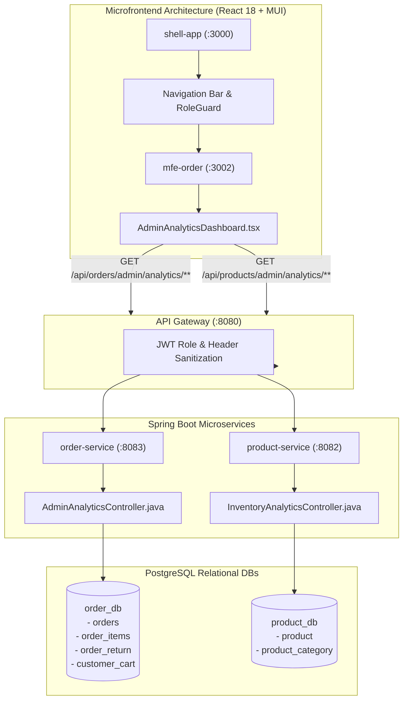

# Universal Commerce Platform — Admin Business Analytics Implementation Report

**Platform:** Universal Commerce Platform (UCP) v2.0.0 / v3.0.0  
**Status:** Completed & Production Ready  
**Date:** October 23, 2026  
**Lead Architect:** Senior Full-Stack Architect & Quality Assurance Lead  

---

## 1. Executive Summary

This deliverable establishes an enterprise-grade, privacy-conscious, and accurate **Admin Business Analytics Engine & Modern Dashboard UX** for the Universal Commerce Platform. Built strictly upon transactional database truth, the implementation adheres strictly to zero-cost architectural principles, completely avoiding third-party paid platforms (Mixpanel, Snowflake, Datadog) and external paid AI APIs.

### Key Capabilities Delivered:
1. **Executive KPI Engine:** GMV, Net Sales, Orders Placed, Delivered Orders, AOV, Cancelled Orders & Rate, Refunds & Rate, Units Sold, and New vs. Returning Buyers with Period-over-Period comparisons ($\Delta\%$) and trend indicators.
2. **Interactive SVG Visualizations:** Zero-dependency, lightweight, reactive time-series charts rendering daily sales curves, comparison period overlays, and order fulfillment status distributions.
3. **Product & Inventory Intelligence:** Top-selling items by revenue and physical units, category breakdowns, slow-moving catalog detection, and warehouse asset valuation grounded in wholesale cost data (`cost_price`).
4. **Customer Retention Intelligence:** Repeat purchase rate calculations and cohort spending rankings.
5. **Operational Health & Alerts:** Real-time signals detecting delayed order fulfillment (>24h), inactive abandoned carts (>2h), and cancellation spikes (>10%).
6. **OWASP Formula Injection Neutralization:** RFC-4180 CSV streaming export sanitizing all cell values starting with `= `, `+`, `-`, `@`, `\t`, or `\r`.
7. **Permission-Checked Analytics AI Copilot:** Instant conversational querying grounded strictly in verified ledger truth with zero external API fees.

---

## 2. Architecture & Service Boundary Mapping



---

## 3. Database Schema Migrations

### 3.1 `product-service`: Migration `V4__product_cost_and_reorder_threshold.sql`
Enables warehouse stock health tracking and wholesale asset valuation:
```sql
ALTER TABLE product ADD COLUMN IF NOT EXISTS cost_price NUMERIC(19, 4);
ALTER TABLE product ADD COLUMN IF NOT EXISTS reorder_threshold INTEGER NOT NULL DEFAULT 10;

UPDATE product SET cost_price = 85.0000, reorder_threshold = 15 WHERE id = 1;
UPDATE product SET cost_price = 60.0000, reorder_threshold = 20 WHERE id = 2;
UPDATE product SET cost_price = 35.0000, reorder_threshold = 25 WHERE id = 3;

CREATE INDEX IF NOT EXISTS idx_product_stock_reorder ON product (stock_quantity, reorder_threshold);
```

### 3.2 `order-service`: Migration `V5__order_analytics_indexes.sql`
Accelerates time-series and filtered aggregation queries:
```sql
CREATE INDEX IF NOT EXISTS idx_orders_created_status ON orders (created_at, status);
CREATE INDEX IF NOT EXISTS idx_orders_user_created ON orders (user_id, created_at);
CREATE INDEX IF NOT EXISTS idx_order_items_product_id ON order_items (product_id);
CREATE INDEX IF NOT EXISTS idx_order_items_order_product ON order_items (order_id, product_id);
```

---

## 4. Source Files Modified and Added

| Microservice / App | File Path | Type | Responsibility |
| :--- | :--- | :--- | :--- |
| **`product-service`** | `.../resources/db/migration/V4__product_cost_and_reorder_threshold.sql` | SQL | Database migration for cost and reorder thresholds |
| **`product-service`** | `.../model/Product.java` | Entity | Added `costPrice` (BigDecimal) and `reorderThreshold` (Integer) |
| **`product-service`** | `.../repository/ProductRepository.java` | Repository | Added low-stock and out-of-stock query methods |
| **`product-service`** | `.../dto/InventoryAnalyticsDto.java` | DTO | Inventory health, valuation, and threshold breach DTO |
| **`product-service`** | `.../service/InventoryAnalyticsService.java` | Service | Database aggregation of units, thresholds, and valuations |
| **`product-service`** | `.../controller/InventoryAnalyticsController.java` | Controller | Role-protected endpoint: `GET /api/products/admin/analytics/inventory` |
| **`order-service`** | `.../resources/db/migration/V5__order_analytics_indexes.sql` | SQL | Database indexing for analytics queries |
| **`order-service`** | `.../dto/AdminOverviewAnalyticsDto.java` | DTO | Executive KPI cards and period comparison DTO |
| **`order-service`** | `.../dto/AdminSalesAnalyticsDto.java` | DTO | Daily time series and order status distribution DTO |
| **`order-service`** | `.../dto/AdminProductAnalyticsDto.java` | DTO | Top selling items and category performance DTO |
| **`order-service`** | `.../dto/AdminCustomerAnalyticsDto.java` | DTO | Customer retention, repeat rate, and spender DTO |
| **`order-service`** | `.../dto/AdminOrderRowDto.java` | DTO | Paginated order table drill-down DTO |
| **`order-service`** | `.../dto/AdminAlertsDto.java` | DTO | Operational health and anomaly signals DTO |
| **`order-service`** | `.../repository/OrderItemRepository.java` | Repository | Database-side aggregates for revenue, units, and line items |
| **`order-service`** | `.../repository/OrderRepository.java` | Repository | Time-bounded and filtered order query methods |
| **`order-service`** | `.../repository/OrderReturnRepository.java` | Repository | Refund sum aggregations |
| **`order-service`** | `.../repository/CustomerCartRepository.java` | Repository | Inactive cart status counting |
| **`order-service`** | `.../service/AdminAnalyticsService.java` | Service | Business logic, canonical math, date windows, and CSV sanitization |
| **`order-service`** | `.../controller/AdminAnalyticsController.java` | Controller | Server-side RBAC enforced endpoints |
| **`order-service`** | `.../AdminAnalyticsIntegrationTest.java` | Test | 8 integration tests verifying metrics, security, and CSV defense |
| **`mfe-order`** | `.../pages/AdminAnalyticsDashboard.tsx` | React / MUI | Interactive admin dashboard UI with SVG charts and AI modal |
| **`mfe-order`** | `.../App.tsx` | Route | Registered `/analytics` route |
| **`shell-app`** | `.../App.tsx` | Route / Nav | Added Analytics navigation pill and profile menu item |
