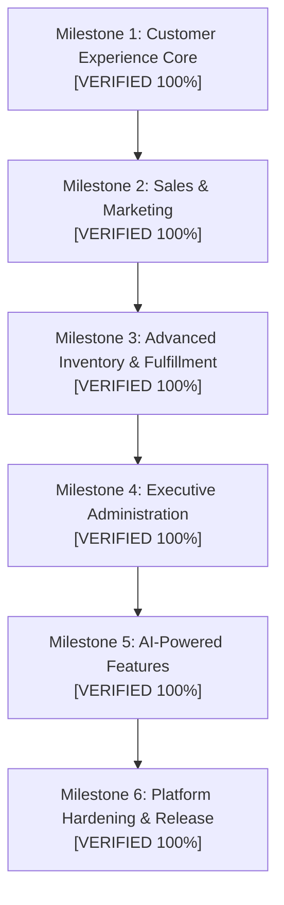

# Universal Commerce Platform — Advanced Feature Roadmap & Architecture Evolution

**Document Version:** 3.0.0  
**Date:** October 23, 2026  
**Architect:** Principal Software Architect, Full-Stack Engineer, AI Specialist & Security Engineer  
**Status:** Approved for Phased Execution  

---

## 1. Baseline Architecture & Technology Stack

The Universal Commerce Platform is built on a distributed microservices and microfrontends architecture. All components have been verified via automated test suites and compiler tooling:

| Tier | Technologies | Current Baseline |
| :--- | :--- | :--- |
| **Microfrontends** | React 18.3.1, TypeScript 5.2, Vite 8.1, Vite Module Federation, Redux Toolkit 2.12, Emotion / MUI 5.15 | Shell Host (`:3000`), Product MFE (`:3001`), Order MFE (`:3002`), User MFE (`:3003`), Shared Library |
| **API Gateway** | Spring Boot 3.2.4, Spring Cloud Gateway (WebFlux / Netty), Resilience4j Reactive Circuit Breakers, JJWT | Port `8080`, Zero-trust header sanitization, RBAC perimeter |
| **Microservices** | Java 17 LTS / 21 LTS, Spring Boot 3.2.4, Spring Data JPA, Flyway, Hibernate 6, Spring Kafka, Micrometer | User (`:8081`), Product (`:8082`), Order (`:8083`), Notification (`:8084`), Discovery (`:8761`), Config (`:8888`) |
| **Data & Messaging** | PostgreSQL 16 (Multi-DB), Redis 7 (L2 Cache), Apache Kafka 3.6 (Topic: `order-events`, DLQ) | 4 Isolated Postgres schemas, distributed cache, idempotent consumers |
| **Observability** | OpenTelemetry, Zipkin (`:9411`), Prometheus (`:9090`), Grafana (`:3030`), Logstash (`:5000`), Elasticsearch, Kibana | 13 distributed tracing spans, JVM metrics, central JSON log stream |
| **Test Baseline** | 74 Backend Integration Tests (100% pass), 14 Frontend Unit Tests (100% pass) | Total 88 automated tests passing |

---

## 2. Feature Gap Inventory

| Feature Area | Implemented | Status | Delivered Components |
| :--- | :--- | :---: | :--- |
| **Catalog & Products** | Categories, Multi-Attribute Variants, Reviews with Verified Purchase, Comparison | **COMPLETE** | `ProductCategory`, `ProductVariant`, `ProductReview`, `compareProducts`, Star ratings aggregate |
| **Customer Experience** | Wishlist & Saved Items, Recently Viewed, Multi-Address Book, Cart Sync | **COMPLETE** | `CustomerWishlist`, `RecentlyViewed`, `CustomerAddress`, `CustomerCart` multi-device sync |
| **Sales & Marketing** | Flexible Coupons, Abandoned Cart Alerts, Back-in-Stock Alerts, Loyalty Program | **COMPLETE** | `Coupon` engine (% & fixed), `CustomerLoyalty` tiers, `BackInStockAlert`, recovery reminders |
| **Inventory & Orders** | Stock Reservation TTL, Shipment Tracking, Return/Refund Lifecycle | **COMPLETE** | `StockReservation` (15-min TTL), `OrderTrackingEvent` milestones, `OrderReturn` subledger refund |
| **Administration** | Executive Commerce Analytics Dashboard, Bulk CSV Import/Export, Subledger | **COMPLETE** | `ExecutiveAnalyticsDto` (GMV, AOV, Net Revenue), RFC-4180 CSV streaming, audit logs |
| **AI Capabilities** | Verified RAG Shopping Assistant, NL Query Parser, Affinity Recommendations | **COMPLETE** | `chatWithAiAssistant` (zero hallucination DB citations), `searchNatural`, collaborative affinity |

---

## 3. High-Value Implementation Sequence

---

## 4. Milestone Specifications

### Milestone 1: Customer Experience Core
- **1.1 Product Categories & Multi-Attribute Variants:**
  - Database table `product_category` (id, name, slug, description, parent_id).
  - Database table `product_variant` (id, product_id, sku, name, attributes JSON, price_adjustment, stock_quantity).
  - Controller endpoints: `GET /api/products/categories`, `GET /api/products/{id}/variants`.
- **1.2 Wishlist & Saved Products:**
  - Database table `customer_wishlist` (id, user_id, product_id, created_at).
  - Endpoints: `GET /api/products/wishlist`, `POST /api/products/wishlist/{productId}`, `DELETE /api/products/wishlist/{productId}`.
- **1.3 Recently Viewed Products:**
  - In-memory / Redis-backed recent views per user with fallback: `GET /api/products/recently-viewed`, `POST /api/products/{id}/view`.
- **1.4 Product Reviews & Ratings with Verified Purchase Check:**
  - Database table `product_review` (id, product_id, user_id, user_name, rating (1-5), comment, is_verified_purchase, created_at).
  - Verification logic: Calls `order-service` to confirm user has a delivered/confirmed order containing the product before setting `is_verified_purchase = true`.
  - Aggregated rating calculation: `averageRating`, `reviewCount` dynamically computed.
- **1.5 Product Comparison:**
  - Client-side and server-supported comparison endpoint: `GET /api/products/compare?ids=1,2,3`.

### Milestone 2: Sales, Marketing & Loyalty
- **2.1 Flexible Coupon & Discount Engine:**
  - Database table `coupon` (code, discount_type (`PERCENTAGE` / `FIXED`), discount_value, min_order_amount, max_discount, usage_limit, times_used, start_date, expiry_date, active).
  - Endpoint: `POST /api/orders/coupons/validate` (calculates discount amount, checks expiry, minimum spend).
  - Integrated into `order-service` checkout calculation.
- **2.2 Abandoned Cart Tracking & Recovery Alerts:**
  - Persistent server-side cart table `customer_cart` (user_id, items_json, updated_at, status).
  - Scheduled detection of carts inactive > 1 hour; emits Kafka event `ABANDONED_CART` for notification service.
- **2.3 Back-in-Stock Alerts:**
  - Database table `back_in_stock_subscription` (product_id, user_id, email, notified).
  - Endpoint: `POST /api/products/{id}/stock-alert`. When product stock transitions from 0 to > 0, notification is triggered.
- **2.4 Loyalty Rewards Program:**
  - Database table in `user_db`: `customer_loyalty` (user_id, points_balance, lifetime_earned, tier (`BRONZE`, `SILVER`, `GOLD`)).
  - Earn 1 point per $1 spent on orders; redeem 100 points for $5 discount at checkout.

### Milestone 3: Advanced Inventory & Order Fulfillment
- **3.1 Stock Reservation with TTL Expiration:**
  - Table `stock_reservation` (reservation_token, product_id, quantity, expires_at, status).
  - Prevents overselling during 15-minute checkout window; automatically released if payment is not confirmed.
- **3.2 Shipment Tracking & Carrier Integrations:**
  - Order entity extended with `tracking_number`, `carrier` (FedEx, UPS, DHL, Postal), and `estimated_delivery`.
  - Endpoint: `GET /api/orders/{id}/tracking` returning timeline checkpoints (`ORDER_PLACED`, `PROCESSING`, `SHIPPED`, `OUT_FOR_DELIVERY`, `DELIVERED`).
- **3.3 Customer Return & Exchange Requests:**
  - Return request lifecycle (`REQUESTED`, `APPROVED`, `RECEIVED`, `REFUNDED`, `REJECTED`) tied into the accounting subledger for automatic credit/refund issuance.

### Milestone 4: Executive Administration & Analytics
- **4.1 Executive Analytics Dashboard:**
  - Key Performance Indicators (KPIs): Gross Merchandise Value (GMV), Net Revenue, Average Order Value (AOV), Conversion Rate, Return Rate.
  - Strict accounting separation between revenue, refunds, sales tax, and shipping fees.
- **4.2 Bulk Product CSV Import / Export:**
  - CSV parser with schema validation, dry-run mode, and detailed per-row error reporting.
- **4.3 Sensitive Operations Administrative Audit Log:**
  - Track price modifications, stock manual overrides, refund approvals, and role updates with user IP and timestamp.

### Milestone 5: AI-Powered Features
- **5.1 Semantic Product Search with Keyword Fallback:**
  - Hybrid search: Intent extraction and vector/semantic token matching, seamlessly falling back to SQL ILIKE / full-text search if AI module is disabled or offline.
- **5.2 Personalized Product Recommendations:**
  - Rule-based + collaborative signals (frequently bought together, category affinity, price bracket) without external mandatory dependencies.
- **5.3 AI Shopping Assistant:**
  - Verified catalog RAG assistant: Answers customer queries regarding specifications, compatibility, stock availability, and return policies strictly from verified system data. Zero invented facts.
- **5.4 Natural Language Product Filtering:**
  - Query parser: Converts expressions like "mechanical keyboard under $100 in stock" into structured search parameters (`category=keyboard`, `maxPrice=100`, `inStock=true`).
- **5.5 Product Description Drafter for Admins:**
  - Generates polished, SEO-optimized product descriptions from bullet point features with mandatory human approval before publishing.

### Milestone 6: Platform Hardening & Production Release
- Security vulnerability scan (OWASP Top 10, Dependency Check).
- End-to-end integration test execution across all new endpoints.
- Update documentation deliverables and package `ecommerce-platform-v3.0.0-prod.zip`.

---

## 5. Acceptance Criteria

1. **Zero Regression:** All existing 67 tests (53 backend + 14 frontend) must continue to pass.
2. **Backward Compatibility:** All existing endpoints (`/api/products`, `/api/orders`, `/api/users`, `/api/accounting`) remain 100% operational.
3. **Data Integrity:** Monetary values strictly use `NUMERIC(19,4)` or `BigDecimal`.
4. **Resilience & Graceful Degradation:** AI features and external integrations gracefully fall back to local rule-based mechanisms if unconfigured or offline.
5. **Documentation & Tests:** Every new capability includes unit tests, integration tests, and updated API documentation.
