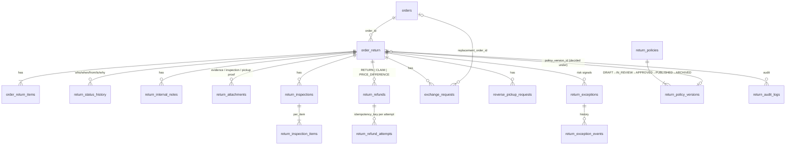

# Returns & Refund Management (RMA)

Part of the **E-commerce Admin** application (Operations → *Returns & Refunds*). It manages return requests, exchanges, refund requests, partial/full returns, reverse pickups, warehouse inspection, refund approval and tracking, and restaurant order claims — for every tenant, store and vendor, without a parallel returns system.

Status of this delivery: see [VERIFICATION_REPORT.md](VERIFICATION_REPORT.md). Nothing is committed or pushed.

| Document | What it covers |
|---|---|
| This file | Architecture assessment, data model (ERD), lifecycle, integration contracts, deployment |
| [API.md](API.md) | Every endpoint, permission and callback |
| [RETURN_POLICY.md](RETURN_POLICY.md) | The configurable policy document, eligibility engine and refund calculation |
| [ADMIN_GUIDE.md](ADMIN_GUIDE.md) | How operators, inspectors, finance and administrators use it |
| [VERIFICATION_REPORT.md](VERIFICATION_REPORT.md) | What was built, tested, blocked and left open |

## 1. Architecture assessment (what existed, what was reused)

| Existing piece | Decision |
|---|---|
| `order_return` / `order_return_items` tables and the `OrderReturn` entity in **order-service** (customer return requests, a header-trusting staff endpoint) | **Extended in place** (migration V9 adds tenant, store, RMA number, kind, resolution, reason, policy version, risk flags, …). No second returns table. |
| `OrderController` `POST /api/orders/{id}/returns` (customer) | **Kept** and re-routed through the new engine (`ReturnService.create`), so customers and operators share one eligibility decision. |
| `OrderController` `GET /api/orders/returns` and `POST /api/orders/returns/{id}/process`, plus `/internal/order-events/return-refund` | **Retired** (HTTP 410 / removed): they trusted `X-User-Role` headers, had no tenant scope and could mark money as refunded. Replaced by the RMA API and the Payment callback below. |
| E-commerce Admin JWT pattern (`AdminAuthenticationFilter`, `AdminPrincipal`, live tenant grant, store scope via token) | **Reused** for `/api/orders/admin/rma/**`. |
| `IdempotencyService` (admin actions and inbound events) | **Reused** (extracted from `OrderAdminService` into a shared bean). |
| Order Control Tower (order state machine, payment gate, fulfillment, service-token callbacks) | **Reused**: an exchange's replacement is an ordinary order; the existing Payment callback confirms any price difference. |
| Kafka `order-events` + notification-service consumer | **Reused** for `RETURN_*` events (idempotent). |
| Stock service (`ReturnStockClient`, `/api/stock/{id}`) and Product service (`/api/products/{id}`) | **Reused** for restocking, availability and current price/category. |
| **Payment** | There is **no Payment service** in this repository. The module owns calculation and tracking only; the money movement and its confirmation are a documented callback contract (§4). |
| **Delivery** | delivery-service exists but has no reverse-pickup endpoint. Reverse logistics uses the same style of contract: an event out (`RETURN_PICKUP_REQUESTED`) and an authenticated progress callback in (§4). No second delivery system was built. |
| `refund_requests` table in `order_db` | **Not ours**: it belongs to accounting-service. RMA tables use the `return_` prefix (`return_refunds`, `return_refund_attempts`). Found during deployment; see the report. |

Where it lives: backend `backend/order-service/.../rma/*`, migrations `V9`/`V10` (order-service) and `V12` (user-service permissions), gateway rule `/api/orders/admin/rma → return:view`, notification consumer messages, frontend `frontend/mfe-order/src/returns/*`, shell menu entry *Returns & Refunds*.

## 2. Lifecycle

```
REQUESTED → UNDER_REVIEW → APPROVED → PICKUP_SCHEDULED → PICKED_UP → IN_TRANSIT → RECEIVED
          → INSPECTION_PENDING → INSPECTION_COMPLETED → REFUND_PENDING → REFUND_PROCESSING → REFUNDED → CLOSED
side exits: REJECTED, CUSTOMER_CANCELLED, PICKUP_FAILED (→ reschedule), RETURN_LOST (→ found/closed),
            INSPECTION_FAILED (→ re-inspect/closed), REFUND_FAILED (→ retry/closed),
            EXCHANGE_PENDING → EXCHANGED (instead of the refund leg)
```

* Restaurant claims use a shorter flow (`REQUESTED → … → APPROVED → REFUND_PENDING → REFUND_PROCESSING → REFUNDED → CLOSED`); they never have pickup, transit or inspection.
* The flow is code (`ReturnStateMachine`); an invalid edge is HTTP 409. Every change stores actor, time, previous and new status, reason, source (`ADMIN`, `CUSTOMER`, `POLICY`, `PAYMENT`, `DELIVERY`, `ORDER`) and a correlation id, and is a compare-and-set on the current status.
* **Ownership gates** — nobody can set these by hand: `REFUNDED`/`REFUND_FAILED` come only from the Payment callback; `PICKED_UP`/`IN_TRANSIT`/`PICKUP_FAILED`/`RETURN_LOST` only from the Delivery callback; `INSPECTION_COMPLETED`, `REFUND_PROCESSING`, `EXCHANGED`, `PICKUP_SCHEDULED`, `APPROVED`, `REJECTED` only through their dedicated, permission-checked actions.

## 3. Data model



Also: `return_settings` (per-tenant thresholds) and two columns on `orders` (`exchange_of_return_id`, `exchange_payment_required`). Every table carries `tenant_id`; store scope is `order_return.store_id`. Monetary columns are `NUMERIC(19,2)`. Unique constraints enforce: one RMA number and one request key per tenant, one open exception per (return, category, key), one attempt number and one idempotency key per refund attempt, one policy per (tenant, store, kind).

Migrations: `V9__returns_and_refunds_management.sql` (schema), `V10__returns_rma_number_backfill.sql` (RMA numbers for pre-existing returns); user-service `V12__returns_refunds_permissions.sql` (19 permissions, 5 roles). All SQL is in the PostgreSQL/H2 common subset; the tests run the real files.

## 4. Integration contracts

**Payment** (not present in this repo — it must implement this):

1. Operator presses *Send to Payment* → order-service records attempt `rf-{refundId}-{n}` (status `PENDING`), sets the refund `PROCESSING`, and publishes `RETURN_REFUND_REQUESTED` on `order-events` with `referenceId = rf-{refundId}-{n}`, `totalAmount`, and `reason = ORIGINAL|STORE_CREDIT:{refundId}`.
2. Payment performs the refund and calls `POST /internal/return-events/refund` with headers `X-Service-Token`, `X-Tenant-Id` and body `{eventId, attemptKey, status: SUCCEEDED|FAILED, paymentReference, amount, failureReason}`.
3. Only then does the refund become `COMPLETED` and the return `REFUNDED` (or `FAILED`/`REFUND_FAILED`). A wrong amount is refused (409), keeps the refund `PROCESSING` and raises a critical review item. Repeated `eventId`s are acknowledged without effect; a late result for a settled attempt is ignored. A retry creates a new attempt key.
4. This module never writes to payment or accounting tables.

**Delivery** (reverse pickup): scheduling publishes `RETURN_PICKUP_REQUESTED` with `referenceId = RP-{pickupId}`; Delivery reports `POST /internal/return-events/pickup` `{eventId, pickupReference, status: PICKED_UP|IN_TRANSIT|AT_WAREHOUSE|FAILED|LOST, partner, trackingReference, proofReference, failureReason}`. Reports are idempotent, may skip steps (each intermediate status is still recorded), and older/duplicate reports are ignored.

**Product / Stock**: current price, category and availability for exchanges and category rules; restock of accepted, resellable goods after inspection. Unknown stock is treated as *not in stock*.

Both callback endpoints fail closed when `SERVICE_TO_SERVICE_TOKEN` is unset, authenticate before reading the body, and are not routed by the gateway.

## 5. Deployment

```bash
cd backend && ./mvnw -pl order-service,user-service,notification-service,api-gateway package
cd .. && docker compose up -d --build order-service user-service notification-service api-gateway mfe-order shell-app
```

* Flyway applies order-service V9/V10 and user-service V12 on start; the services run with `ddl-auto: validate`.
* Config added: `backend/config-repo/order-service.yml` (multipart 6 MB/7 MB, `returns.attachments.max-bytes`), `docker-compose.yml` (volume `return_evidence_data` mounted at `/data/return-evidence`, env `RETURNS_ATTACHMENTS_DIR`), `Dockerfile.order` (directory owned by the app user).
* Evidence files are private: stored outside the database, never served from a public URL, downloaded only through the authenticated, tenant- and store-checked endpoint. **Back up the `return_evidence_data` volume with the database.**
* Required roles: grant tenant users one of `RETURNS_MANAGER`, `RETURNS_AGENT`, `WAREHOUSE_INSPECTOR`, `REFUND_APPROVER`, `RETURNS_ANALYST` (plus store access) in the tenant admin.
* Rollback: the migrations are additive; the previous jar can run against the new schema, except that the retired legacy endpoints would be back. Drop nothing.
