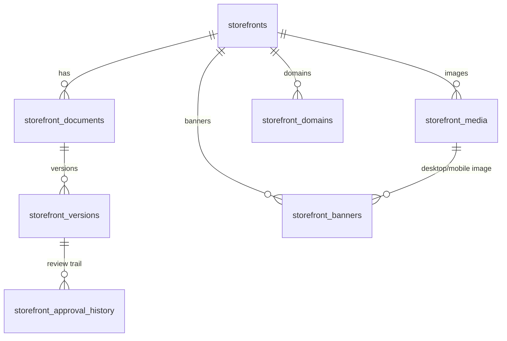

# Storefront Management & Content Studio (E-commerce Admin)

Lets each tenant create, customise, preview, review and publish its own storefront (retail or restaurant, one or many stores) without code changes.

## 1. Architecture assessment

| Question | Finding |
|---|---|
| Existing storefront/content module? | None. The only storefront code is the public product page in `mfe-product`. Nothing was duplicated. |
| Where does it live? | `product-service` (package `com.ecommerce.product.storefront`): it owns the catalog and already has the E-commerce Admin JWT + application-grant filter and tenant-scoped admin pattern. UI in `frontend/mfe-product/src/storefront`, menu **Operations → Storefront Management** (`/products/storefront`). |
| Object storage | The repo has none (`file-storage-app` is a separate project outside this repo). Images go through a `MediaStorage` interface; the shipped adapter writes to a directory/volume (`storefront.media.dir`, a named Docker volume in compose). Metadata only is in the database. An S3 adapter is a drop-in replacement and is **pending**. |
| Catalog data | Never copied. Product/category references are resolved from the authoritative `product`/`product_prices`/`product_category` tables at read time, so price and stock are always current. |
| Restaurant data | The platform has **no restaurant/menu service**, so dishes, food images and per-dish veg/prep-time are **not implemented** (nothing to read them from). Opening hours, ordering availability, veg-indicator/prep-time display flags and `Restaurant` structured data are implemented. |
| Tenant identity | Admin: tenant comes only from the verified JWT. Public: derived server-side from the storefront slug or a **verified** custom domain in our tables; never from a header or parameter. |

| Layer | Component |
|---|---|
| Schema | `product-service/.../V8__storefront_content_studio.sql` (new; nothing applied was edited) |
| Permissions/roles | `user-service/.../V10__storefront_permissions.sql` |
| Admin API | `StorefrontAdminController` `/api/products/admin/storefront/**` |
| Public API | `PublicStorefrontController` `/api/products/public/storefront/**` (anonymous, GET, published content only) |
| Content rules | `ContentValidator` (closed vocabulary of typed blocks) |
| Workflow | `StorefrontService` (versions, review, publish, schedule, rollback, compare, audit) |
| Media / banners / domains / presets | `MediaService`, `BannerService`, `DomainService`, `ThemePresetService` |
| Delivery | `StorefrontRenderer` (media ids → URLs, live catalog resolution), `PublicStorefrontService` (site, pages, banners, sitemap, robots, JSON-LD) |
| Gateway | `routePermission`: `/api/products/admin/storefront/**` requires `storefront:read` (coarse); the service checks the exact permission |

## 2. ERD

`storefront_documents.doc_type` ∈ HOMEPAGE, LANDING (one per slug), THEME, NAVIGATION, SETTINGS. A document points at its live version through `published_version_id`.
Also: `storefront_theme_presets` (tenant presets) and `storefront_audit_logs`. All tables carry `tenant_id`; a storefront is unique per `(tenant, store_id)` and by global `slug` (the subdomain). Landing slugs are unique per storefront; domains are globally unique.

## 3. Publishing model

`DRAFT → IN_REVIEW → APPROVED → PUBLISHED → ARCHIVED`. Content lives in `storefront_versions`; **only a DRAFT's content is ever updated** (SQL guard `status='DRAFT'`). Editing after a publish starts a new draft version; the public site keeps serving the published snapshot until a new version is explicitly published. The reviewer cannot be the submitter. Publishing archives the previous live version. Rollback copies an archived version into a *new* live version (history is never rewritten, open drafts are kept). Scheduling is APPROVED + `scheduled_publish_at`; a scheduler applies due versions (`storefront.scheduler.delay-ms`, default 30 s). Every action writes `storefront_approval_history` and `storefront_audit_logs`.

## 4. Deploy / configuration

1. `user-service` first (V10: 8 permission keys; roles `STOREFRONT_MANAGER`, `CONTENT_EDITOR`, `STOREFRONT_PUBLISHER`; `ADMIN` gets all).
2. `product-service` (Flyway V7 then V8). New settings: `storefront.media.dir` (env `STOREFRONT_MEDIA_DIR`, mounted volume in compose), `storefront.media.max-bytes` (5 MB), `spring.servlet.multipart.max-file-size` (6 MB), `storefront.base-domain` (env `STOREFRONT_BASE_DOMAIN`, platform wildcard domain for slug subdomains), `storefront.edge-host` (env `STOREFRONT_EDGE_HOST`, the CNAME target shown in domain instructions; **must be set** for useful DNS instructions).
3. `api-gateway`, then the frontend shell and `mfe-product`.
4. Custom domains need operator-side edge/TLS (ingress or CDN that routes `Host` to the storefront and issues certificates). This module records/verifies state; it does not provision certificates.

Rollback: V8 only adds tables. Remove the roles/permissions rows in user-service if reverting.

Docs: [API](API.md) · [User guide](USER_GUIDE.md) · [Verification report](VERIFICATION_REPORT.md)
