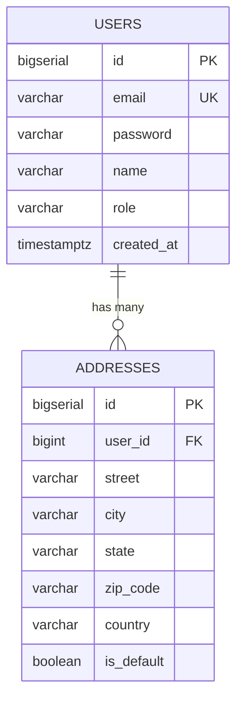
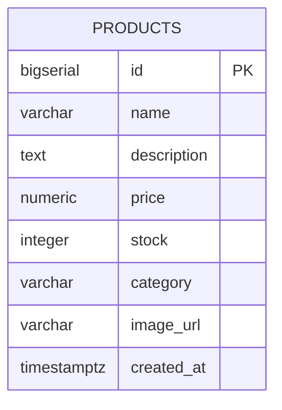
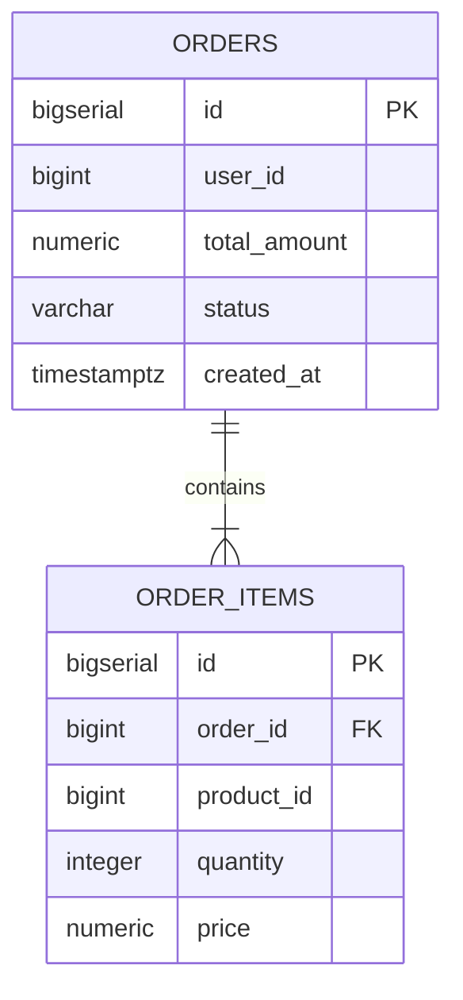
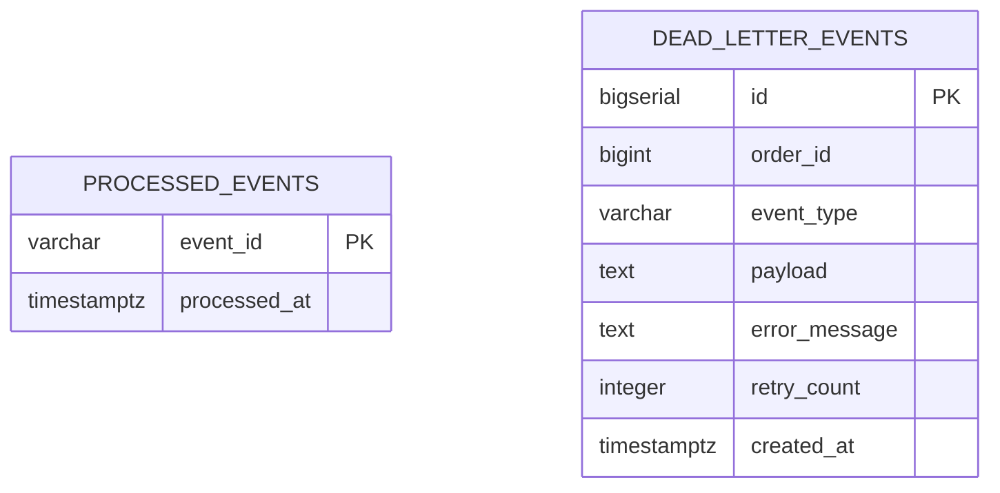

# Entity-Relationship Diagrams (ERD)

**Universal Commerce Platform**  
*Document Version:* 2.0.0

---

## 1. User Service ERD (`user_db`)

---

## 2. Product Service ERD (`product_db`)

---

## 3. Order Service ERD (`order_db`)

---

## 4. Notification Service ERD (`notification_db`)

