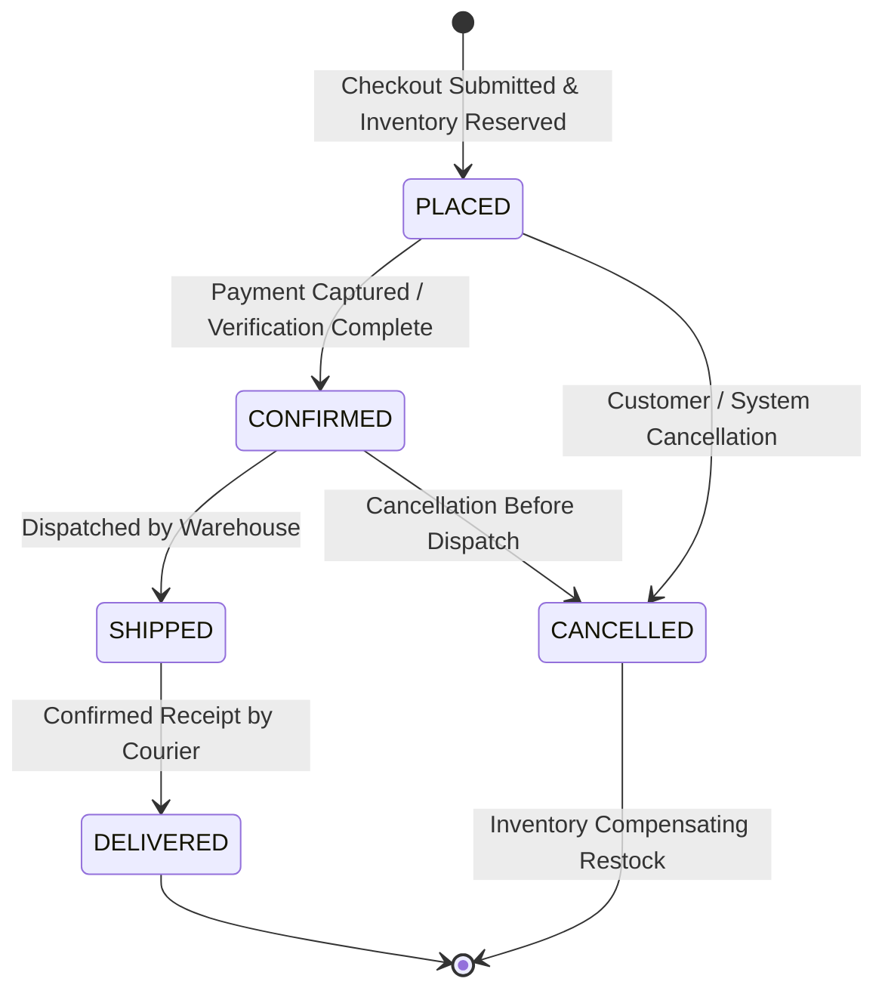

# Order Lifecycle & State Machine Specification

**Universal Commerce Platform**  
*Document Version:* 2.0.0

---

## 1. Order State Machine Overview

Order lifecycles are modeled as a deterministic state machine within `order-service`. Every state transition enforces validation rules and triggers corresponding Kafka events:

---

## 2. State Transition Matrix & Invariants

| Current State | Target State | Permitted Roles | Actions & Side Effects |
| :--- | :--- | :--- | :--- |
| `[INIT]` | `PLACED` | `ROLE_USER` | Server price calculation, inventory decrement in `product-service`, publish `ORDER_CREATED`. |
| `PLACED` | `CONFIRMED` | `ROLE_MANAGER`, `ROLE_ADMIN` | Payment clearance, lock order details, publish `ORDER_CONFIRMED`. |
| `CONFIRMED` | `SHIPPED` | `ROLE_MANAGER`, `ROLE_ADMIN` | Attach tracking code, publish `ORDER_SHIPPED`. |
| `SHIPPED` | `DELIVERED` | Courier Webhook / Admin | Mark order complete, publish `ORDER_DELIVERED`. |
| `PLACED` / `CONFIRMED` | `CANCELLED` | `ROLE_USER`, `ROLE_ADMIN` | Trigger compensating inventory restock call, publish `ORDER_CANCELLED`. |

---

## 3. Illegal State Transitions

The system raises an `IllegalStateException` (HTTP 400 Bad Request) under the following conditions:
- Attempting to transition from `SHIPPED` or `DELIVERED` to `CANCELLED`.
- Attempting to skip states (e.g. `PLACED` directly to `DELIVERED`).
- Any mutation of an order once in a terminal state (`DELIVERED` or `CANCELLED`).
